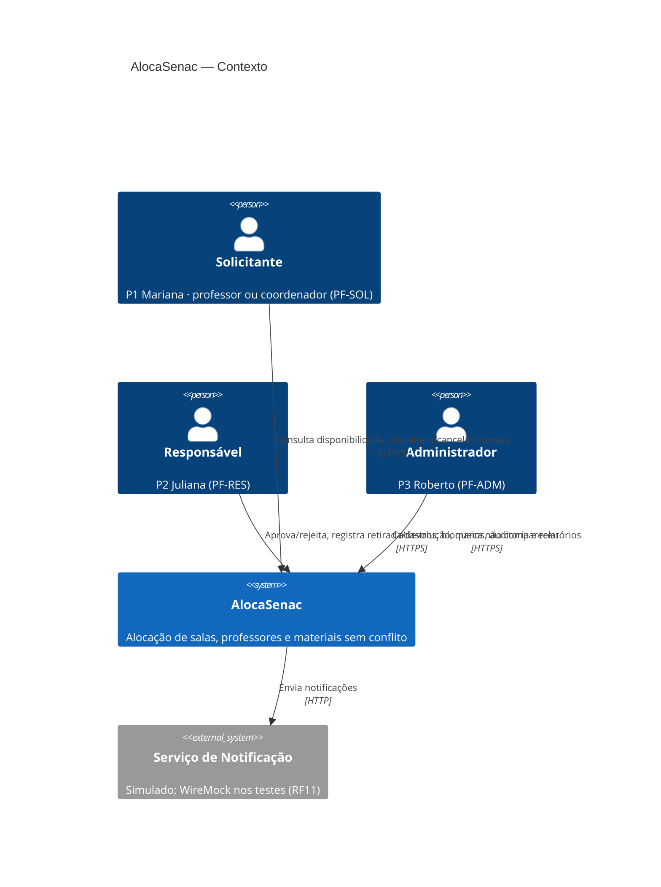
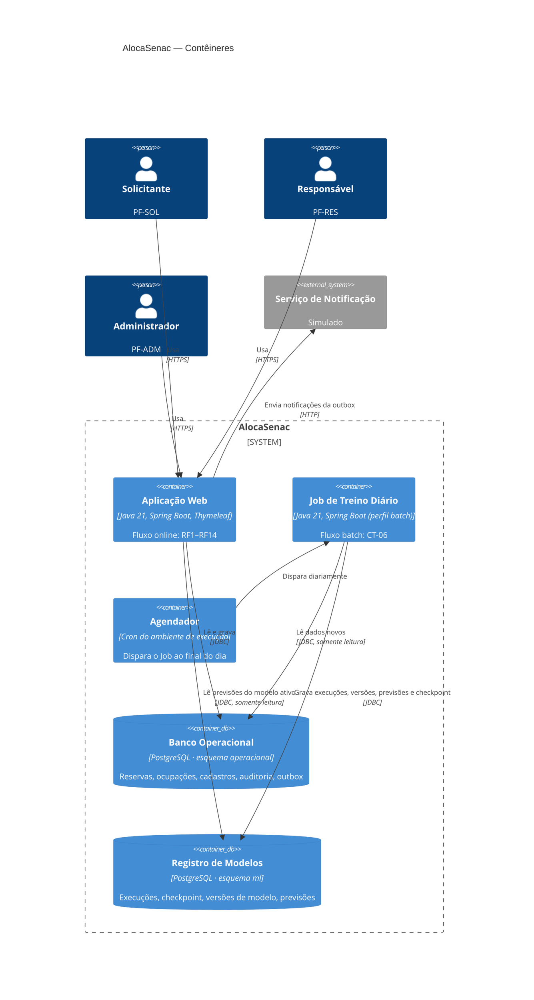
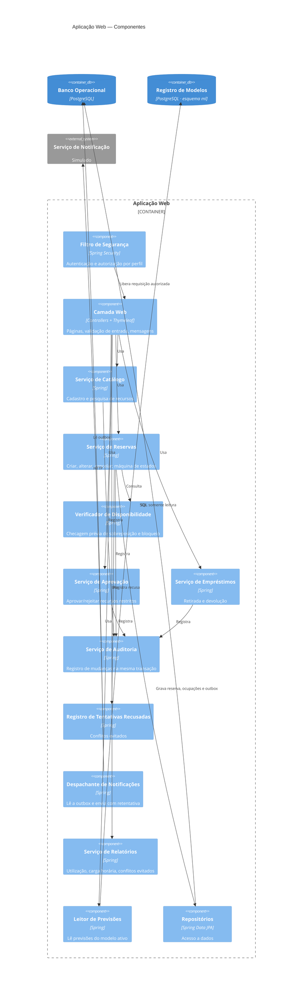
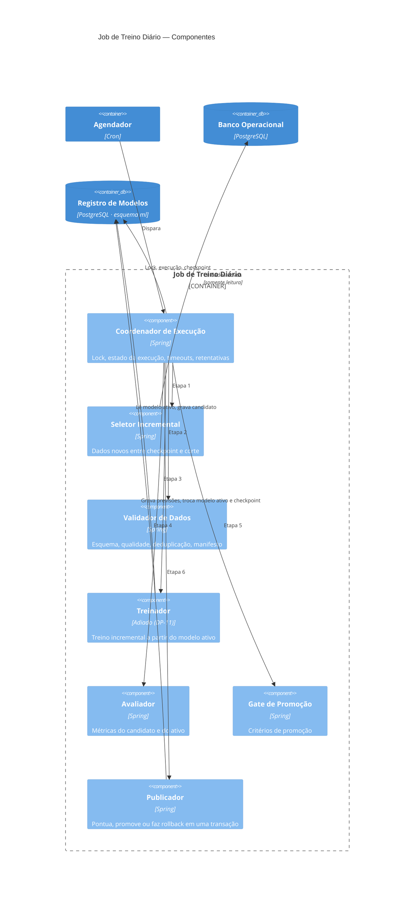

# AlocaSenac — Arquitetura

> **Estado deste documento:** Prompt 1 (descoberta e drivers, §1–§9) Prompt 2 (arquitetura C4 e pipeline diário, §10–§21), Prompt 3 (ATAM, §22) e Prompt 4 (revisão cruzada, ADRs e rastreabilidade, §23–§29) concluídos. §30 consolida cada decisão relevante de ponta a ponta, no formato do exemplo resolvido do roteiro (seção 10).
> **Como ler:** a origem de cada decisão está na ADR (§26); a matriz (§27) liga requisito → ADR → componente → evidência; o que ainda está em aberto está em §28. Trechos marcados *Revisão P4* foram corrigidos pelo painel revisor (§23–§24), com o texto original preservado.
> **Convenção:** **[F]** fato confirmado em artefato · **[L]** lacuna · **[C]** conflito · **[S]** suposição · **[P]** pergunta aberta. Suposição nunca é tratada como fato.

---

## 1. Contexto e objetivo

**Contexto [F].** O AlocaSenac organiza a alocação de salas, professores e materiais sem conflitos de horário. A avaliação do projeto prioriza evidências objetivas de qualidade, segurança, rastreabilidade e desempenho, não apenas o funcionamento. — *origem:* `docs/requisitos.md` §1.

**Objetivo deste documento.** Registrar a base factual da arquitetura: quem usa, o que é exigido, o que falta e o que se está assumindo. Esta base orienta a escolha de estrutura (Prompt 2), a avaliação por cenários (Prompt 3) e as decisões registradas (Prompt 4).

**Restrição adicional desta atividade.** Um cron job roda diariamente ao final do dia para treinar ou retreinar um modelo usando somente dados novos. — *origem:* **restrição fornecida pelo professor** (roteiro da prática guiada, seção 9, prompt 1). Esta restrição **não aparece** nos artefatos de requisitos; ver conflito **C-01**.

---

## 2. Fonte de verdade (artefatos consultados)

| Caminho | Conteúdo usado | Papel |
|---|---|---|
| `docs/requisitos.md` | Objetivo, perfis, RF1–RF14, RN-T1–RN-T4, RN-E1–RN-E5, RQ-1–RQ-7, MT-1–MT-4, entregáveis, pesos, LIM-1–LIM-4, cronograma | **Fonte primária** (reprodução da especificação do professor) |
| `docs/prd.md` | Personas P1–P3, escopos E1–E4, fora de escopo | Fonte primária para personas e escopo |
| `pom.xml` | Spring Boot 3.5.16, Java 21, starters Web, Security, Data JPA, Validation, Thymeleaf, driver PostgreSQL, Testcontainers | Decisões anteriores (marco zero) |
| `README.md` | Pré-requisitos (Java 21, Docker), execução via `spring-boot:test-run`, testes via `mvnw test` | Decisões anteriores (marco zero) |
| `src/test/java/br/senac/alocasenac/TestcontainersConfiguration.java` | Existência da configuração de PostgreSQL em container para testes | Evidência de decisão anterior |
| `docs/plano-de-teste.md` | Apenas esqueleto (`TODO`) | Sem conteúdo utilizável |

Identificadores: a especificação numera os requisitos funcionais de 1 a 14 e não codifica as regras; os IDs `RF*`, `RN-*`, `RQ-*`, `MT-*`, `LIM-*` foram atribuídos em `docs/requisitos.md` a partir da ordem da página e são preservados aqui.

---

## 3. Stakeholders e personas

| ID | Stakeholder / persona | Perfil (spec) | Interesse arquitetural | Origem |
|---|---|---|---|---|
| P1 | Profa. Mariana Costa | PF-SOL Solicitante | Disponibilidade confiável, nenhuma dupla reserva, confirmação, uso **principalmente pelo celular** | `docs/prd.md` §3; `docs/requisitos.md` §2 |
| P2 | Juliana Rocha | PF-RES Responsável | Aprovação de recursos restritos, validação de alocação de docentes, registro de retirada/devolução, "não compareceu" | `docs/prd.md` §3; `docs/requisitos.md` §2 |
| P3 | Roberto Lima | PF-ADM Administrador | Cadastros corretos, bloqueios de manutenção, **histórico de quem mudou o quê**, relatórios | `docs/prd.md` §3; `docs/requisitos.md` §2 |
| SH-PROF | Professor da disciplina (avaliador) | — | Evidências de qualidade, metas MT-1–MT-4, limitadores LIM-1–LIM-4, restrição do cron job | `docs/requisitos.md` §6, §8; roteiro da aula |
| SH-EQP | Equipe de desenvolvimento | — | Prazo da semana 46, entregáveis, pipeline e testes | `docs/requisitos.md` §1, §7, §9 |

Observação: o perfil Solicitante inclui "professor **ou coordenador**" (`docs/requisitos.md` §2), mas nenhuma persona representa o coordenador. Ver **L-02**.

---

## 4. Requisitos arquiteturalmente significativos (ASR)

Um requisito é significativo quando força uma decisão de estrutura, dados, concorrência, segurança ou implantação, ou quando é um limitador de nota.

| ID ASR | Requisitos de origem | Por que é significativo | Origem |
|---|---|---|---|
| ASR-01 | RF5, RF6, RN-T2, RN-T3, RQ-3, LIM-4 | Exige garantia de exclusão mútua por recurso e por intervalo, sob concorrência real, verificada por teste automatizado. Dupla reserva limita a nota. | `docs/requisitos.md` §3, §4.1, §5, §8 |
| ASR-02 | RF1, RN-E3, RQ-6, LIM-3 | Autorização por perfil em todas as operações; falha de autorização limita a nota. | `docs/requisitos.md` §3, §4.2, §5, §8 |
| ASR-03 | RN-E1, RN-E2, RN-E4 | Máquina de estados explícita da reserva, com transições proibidas (ex.: apagar reserva iniciada). | `docs/requisitos.md` §4.2 |
| ASR-04 | RF10, RN-E5 | Toda mudança de estado gera auditoria: o registro de auditoria não pode se perder quando a mudança é aceita. | `docs/requisitos.md` §3, §4.2 |
| ASR-05 | RF8, RN-T4 | Bloqueio de manutenção participa da mesma checagem de disponibilidade das reservas. | `docs/requisitos.md` §3, §4.1 |
| ASR-06 | RF7, RN-E3 | Fluxo de aprovação condicionado ao atributo "restrito" do recurso. | `docs/requisitos.md` §3, §4.2 |
| ASR-07 | RF11, RQ-2, RQ-7 | Integração externa (notificação) isolada atrás de uma interface substituível por WireMock nos testes. | `docs/requisitos.md` §3, §5 |
| ASR-08 | RQ-1, RQ-2, RQ-7, MT-1, MT-2 | A arquitetura precisa permitir testes unitários isolados e testes de integração com banco real em container. | `docs/requisitos.md` §5, §6 |
| ASR-09 | RQ-5, LIM-1, LIM-2 | Build reproduzível em CI (GitHub Actions) com JaCoCo e SonarCloud; aplicação precisa executar. | `docs/requisitos.md` §5, §8 |
| ASR-10 | RF12 | Relatório de utilização, carga horária e **conflitos evitados**: exige registrar tentativas recusadas por conflito, não só reservas aceitas. | `docs/requisitos.md` §3 |
| ASR-11 | RF13 | Interface responsiva (uso pelo celular de P1) e mensagens de erro compreensíveis. | `docs/requisitos.md` §3; `docs/prd.md` §3 (P1) |
| ASR-12 | RF14 | Documentação de API ou dos fluxos públicos. | `docs/requisitos.md` §3 |
| ASR-13 | Restrição do professor | Cron job diário de treino/retreino só com dados novos: introduz um fluxo batch ao lado do fluxo online. | **restrição fornecida pelo professor** |

---

## 5. Atributos de qualidade

| Atributo | Evidência nos artefatos | Requisitos | Meta numérica nos artefatos? |
|---|---|---|---|
| **Integridade / consistência** (sem sobreposição, sem dupla reserva) | Regras críticas e limitador LIM-4 | RF5, RF6, RN-T1–RN-T4, RQ-3 | Não há meta numérica; a regra é absoluta ("uma única reserva aceita") |
| **Segurança** (autenticação, autorização, validação de entrada, erros seguros) | RF1, RQ-6, LIM-3 | RF1, RN-E3, RQ-6 | MT-4: 0 vulnerabilidades críticas |
| **Auditabilidade / rastreabilidade** | Histórico auditável, auditoria em toda mudança, dor de P3 | RF10, RN-E5 | MT-3: 100% dos requisitos críticos na RTM |
| **Testabilidade** | Estratégia obrigatória de qualidade, peso 25% + 15% | RQ-1–RQ-7 | MT-1: 80% linhas; MT-2: 70% branches |
| **Desempenho sob concorrência** | JMeter (RQ-6), semana 42: reservas simultâneas sob carga | RQ-6, RN-T3 | **Não** — nenhum volume, latência ou vazão definidos (**L-04**) |
| **Usabilidade** | Responsividade e mensagens claras; P1 usa pelo celular | RF13 | Não |
| **Modificabilidade / integrabilidade** | Notificação simulada ou API externa; WireMock | RF11, RQ-2 | Não |
| **Implantabilidade / executabilidade** | Aplicação executável, pipeline de CI | RQ-5, LIM-1, LIM-2 | Não |
| **Disponibilidade** | Nenhuma menção direta | — | Não (**L-05**) |
| **Confiabilidade do batch** (idempotência, recuperação) | Apenas a restrição do professor | ASR-13 | Não (**L-09**) |

---

## 6. Drivers priorizados

Critério de prioridade: (1) limitador de nota → (2) peso na avaliação → (3) dor explícita de persona → (4) restrição da atividade.

| Prioridade | Driver | Tipo | Origem | ASR |
|---|---|---|---|---|
| **D1** | Nenhuma dupla reserva, inclusive na agenda do professor e sob solicitações simultâneas | Negócio + qualidade | `docs/requisitos.md` RF5, RF6, RN-T2, RN-T3, LIM-4; `docs/prd.md` P1 (dor "dupla reserva") | ASR-01, ASR-05 |
| **D2** | Autorização correta por perfil | Qualidade (segurança) | `docs/requisitos.md` RF1, RN-E3, RQ-6, LIM-3 | ASR-02, ASR-06 |
| **D3** | Aplicação executável e pipeline de CI presente | Restrição de entrega | `docs/requisitos.md` LIM-1, LIM-2, RQ-5 | ASR-09 |
| **D4** | Testabilidade com ambiente realista e metas de cobertura | Restrição técnica | `docs/requisitos.md` RQ-1–RQ-7, MT-1, MT-2; peso 25% "Qualidade dos testes automatizados" | ASR-07, ASR-08 |
| **D5** | Auditoria completa de mudanças de estado | Negócio + qualidade | `docs/requisitos.md` RF10, RN-E5; `docs/prd.md` P3 (dor "sem histórico de quem mudou o quê") | ASR-03, ASR-04 |
| **D6** | Controle de recursos restritos e de empréstimos | Negócio | `docs/requisitos.md` RF7, RF9; `docs/prd.md` P2 (dores "empréstimo sem registro", "sala restrita usada sem autorização") | ASR-06 |
| **D7** | Uso pelo celular com mensagens compreensíveis | Usabilidade | `docs/requisitos.md` RF13; `docs/prd.md` P1 | ASR-11 |
| **D8** | Relatórios de utilização e conflitos evitados | Negócio | `docs/requisitos.md` RF12; `docs/prd.md` P3 | ASR-10 |
| **D9** | Cron job diário de treino/retreino somente com dados novos, sem afetar o fluxo online | Restrição da atividade | **restrição fornecida pelo professor** | ASR-13 |

### Restrições (não negociáveis nesta fase)
| ID | Restrição | Origem |
|---|---|---|
| CT-01 | Java 21 e Spring Boot 3.x | `docs/requisitos.md` §1 |
| CT-02 | JUnit 5, Testcontainers, WireMock, JaCoCo, SonarCloud, GitHub Actions, JMeter | `docs/requisitos.md` RQ-1, RQ-2, RQ-5, RQ-6 |
| CT-03 | Mocks apenas em testes unitários isolados | `docs/requisitos.md` RQ-7 |
| CT-04 | Entrega na semana 46 | `docs/requisitos.md` §1, §9 |
| CT-05 | Sem integração com sistemas acadêmicos reais, sem app nativo, sem envio real de e-mail/SMS/push, sem cobrança, sem reservas recorrentes complexas e multi-unidade com fuso horário | `docs/prd.md` §5 |
| CT-06 | Cron job diário ao final do dia, treino/retreino somente com dados novos | **restrição fornecida pelo professor** |

### Decisões anteriores (marco zero)
| ID | Decisão | Origem | Requisito que a justifica |
|---|---|---|---|
| DA-01 | Spring Boot **3.5.16**, Java 21, Maven Wrapper | `pom.xml`, `README.md` | CT-01 |
| DA-02 | PostgreSQL como banco; PostgreSQL em container (Testcontainers) para testes e execução local | `pom.xml`, `TestcontainersConfiguration.java`, `README.md` | RQ-2 |
| DA-03 | Thymeleaf (+ extras Spring Security) para a interface web | `pom.xml` | RF13 (parcial: responsividade ainda não garantida) |
| DA-04 | Spring Security, Spring Data JPA, Bean Validation | `pom.xml` | RF1, RQ-6 |

> A escolha de **PostgreSQL** não decorre de requisito explícito: a especificação pede "banco containerizado" (RQ-2), sem indicar o produto. Fica registrada como decisão anterior a ser formalizada em ADR no Prompt 4.

---

## 7. Glossário

| Termo | Definição | Origem |
|---|---|---|
| Recurso | Sala, professor ou material que pode ser reservado | `docs/requisitos.md` RN-T2 |
| Recurso restrito | Recurso cuja reserva exige aprovação de um Responsável | `docs/requisitos.md` RF7, RN-E3 (critério de "restrito" não definido: **L-06**) |
| Reserva | Alocação de um ou mais recursos em um intervalo de início e término | `docs/requisitos.md` RF4, RN-T1 |
| Sobreposição | Dois intervalos do mesmo recurso que se interceptam no tempo | `docs/requisitos.md` RF5, RN-T2 |
| Dupla reserva | Duas reservas aceitas para o mesmo recurso em intervalos sobrepostos | `docs/requisitos.md` RF6, RN-T3, LIM-4 |
| Bloqueio de manutenção | Período em que um recurso não pode ser reservado | `docs/requisitos.md` RF8, RN-T4 |
| Retirada / devolução | Registro de saída e retorno de material ou equipamento | `docs/requisitos.md` RF9 |
| Estados da reserva | SOLICITADA, APROVADA, EM_USO, CONCLUÍDA; alternativos: rejeitada, cancelada, não compareceu | `docs/requisitos.md` RN-E1, RN-E2 |
| Auditoria | Registro de cada mudança (quem, o quê, quando) | `docs/requisitos.md` RF10, RN-E5; `docs/prd.md` P3 |
| Conflito evitado | Tentativa de reserva recusada por sobreposição ou bloqueio | `docs/requisitos.md` RF12 (definição operacional é **[S]**) |
| RTM | Matriz de rastreabilidade requisito → risco → teste → evidência | `docs/requisitos.md` §7 |
| Fluxo online | Operações interativas dos usuários (consultas, reservas, aprovações) | Termo deste documento |
| Fluxo batch | Execução agendada do cron job diário | **restrição fornecida pelo professor** |
| Dados novos | Registros criados ou alterados após a última execução bem-sucedida do batch | **[S]** interpretação da restrição do professor (**P-12**) |
| Watermark / checkpoint | Marca persistida do último dado processado pelo batch | Termo do roteiro da aula; usado a partir do Prompt 2 |

---

## 8. Fatos, lacunas, conflitos, suposições e perguntas

### 8.1 Fatos confirmados [F]
- F-01 — Há três perfis: Solicitante, Responsável, Administrador. (`docs/requisitos.md` §2)
- F-02 — Há 14 requisitos funcionais obrigatórios (RF1–RF14). (`docs/requisitos.md` §3)
- F-03 — Reservas do mesmo recurso não podem se sobrepor, e duas solicitações simultâneas produzem uma única reserva aceita. (`docs/requisitos.md` RN-T2, RN-T3)
- F-04 — A agenda do professor também entra na detecção de sobreposição. (`docs/requisitos.md` RF5)
- F-05 — Fluxo principal de estados e três estados alternativos definidos. (`docs/requisitos.md` RN-E1, RN-E2)
- F-06 — Reservas iniciadas não podem ser apagadas. (`docs/requisitos.md` RN-E4)
- F-07 — Toda mudança de estado gera auditoria. (`docs/requisitos.md` RN-E5)
- F-08 — Metas: 80% de linhas, 70% de branches, 100% dos requisitos críticos na RTM, 0 bugs ou vulnerabilidades críticas. (`docs/requisitos.md` MT-1–MT-4)
- F-09 — Limitadores de nota: não executar, pipeline ausente, falha de autorização, dupla reserva. (`docs/requisitos.md` LIM-1–LIM-4)
- F-10 — Notificação pode ser simulada ou integrada a uma API externa; o envio real está fora de escopo. (`docs/requisitos.md` RF11; `docs/prd.md` §5)
- F-11 — Interface web responsiva; app nativo fora de escopo. (`docs/requisitos.md` RF13; `docs/prd.md` §5)
- F-12 — A stack do marco zero é Spring Boot 3.5.16, Java 21, PostgreSQL, Thymeleaf. (`pom.xml`)
- F-13 — P1 usa o sistema principalmente pelo celular. (`docs/prd.md` §3)

### 8.2 Lacunas [L]
- L-01 — Não há requisito, dado ou objetivo de **aprendizado de máquina** que defina o que o cron job treina. (ver **C-01**)
- L-02 — O coordenador (perfil Solicitante) não tem persona; não se sabe se as necessidades dele diferem das de P1.
- L-03 — Não há volumes: número de usuários, recursos, unidades, reservas por dia, pico de uso.
- L-04 — Não há metas de desempenho (latência, vazão, usuários simultâneos) para o teste de JMeter (RQ-6).
- L-05 — Não há meta de disponibilidade, horário de operação ou janela de manutenção do sistema.
- L-06 — Não há critério para classificar um recurso como **restrito**.
- L-07 — Não está definido o que é "competência" de um professor (RF3) nem como ela é cadastrada.
- L-08 — Não está definido quando e por quem uma reserva passa a "não compareceu", nem em que estados é permitido cancelar ou alterar.
- L-09 — Não há requisito de retenção, LGPD ou tratamento de dados pessoais (nomes, e-mails e agenda de professores).
- L-10 — Não há definição de "final do dia" (horário), fuso horário de referência nem duração máxima da janela do batch.
- L-11 — Não está definido se a alteração de uma reserva APROVADA de recurso restrito exige nova aprovação.
- L-12 — Não há definição dos eventos que disparam notificação (RF11).
- L-13 — RF14 aceita "API **ou** fluxos públicos": não está decidido se haverá API REST além da interface Thymeleaf.
- L-14 — Não há requisito de backup, recuperação de desastre ou ambiente de produção (apenas execução local e CI).

### 8.3 Conflitos [C]
- **C-01 — Cron job de ML × escopo do produto.** A restrição do professor exige treino/retreino diário de um modelo, mas nenhum artefato (`docs/requisitos.md`, `docs/prd.md`) prevê modelo, previsão ou recomendação. O batch introduz um fluxo, dados e riscos que não estão ligados a nenhum RF. *Tratamento:* manter como restrição CT-06 com origem "restrição fornecida pelo professor"; o objetivo do modelo fica como hipótese (S-01 a S-03), sem virar requisito.
- **C-02 — "Somente dados novos" × base inicialmente vazia.** O sistema começa sem histórico; nas primeiras execuções os dados novos podem ser insuficientes para treinar. Nenhum artefato define o comportamento mínimo. (ver **P-13**)
- **C-03 — Perfil Solicitante × persona.** A especificação inclui o coordenador no perfil Solicitante; `docs/prd.md` só representa a professora. Não é contradição, mas a cobertura é parcial. (ver L-02)
- **C-04 — Uso em "2 unidades" (P1) × "multi-unidade com fuso horário" fora de escopo.** P1 trabalha em duas unidades, e o PRD exclui reservas multi-unidade *com fuso horário*. Não está claro se múltiplas unidades no mesmo fuso estão no escopo. (ver **P-05**)

### 8.4 Suposições [S]
> Nenhuma suposição abaixo é requisito. Cada uma deve ser confirmada ou descartada.
- S-01 — *Hipótese de alvo do modelo:* prever a probabilidade de "não compareceu" por reserva, ligada a RN-E2 e à dor de P2.
- S-02 — *Hipótese de alvo do modelo:* prever a demanda por tipo de recurso e faixa de horário, como apoio a RF12.
- S-03 — *Hipótese de alvo do modelo:* sugerir um recurso alternativo quando há conflito, como apoio a RF5 e a P1.
- S-04 — "Dados novos" significa registros criados ou alterados após o último checkpoint bem-sucedido.
- S-05 — O modelo, qualquer que seja, é **consultivo**: não decide aprovação nem disponibilidade, que seguem as regras RN-T* e RN-E*.
- S-06 — O sistema roda em uma única instância de aplicação com um banco, no ambiente acadêmico (sem requisito de escala horizontal).
- S-07 — Todas as unidades estão no mesmo fuso horário.
- S-08 — "Conflito evitado" (RF12) é uma tentativa de criar ou alterar reserva recusada por sobreposição, bloqueio ou concorrência.

### 8.5 Perguntas abertas [P]
- P-01 — O que o modelo do cron job deve prever ou aprender? Quem consome o resultado e em qual tela? (C-01, S-01–S-03)
- P-02 — Quantos usuários, recursos e reservas por dia são esperados? Qual o pico? (L-03)
- P-03 — Qual a meta do teste de carga: usuários simultâneos, latência p95 e taxa de erro aceitável? (L-04)
- P-04 — Há meta de disponibilidade ou horário de funcionamento? (L-05)
- P-05 — Múltiplas unidades no mesmo fuso estão no escopo? (C-04)
- P-06 — Qual critério torna um recurso restrito, e quem define? (L-06)
- P-07 — Como se define e cadastra a competência de um professor? (L-07)
- P-08 — Quem marca "não compareceu" e após quanto tempo? Em quais estados se pode cancelar ou alterar? (L-08)
- P-09 — Alterar uma reserva aprovada de recurso restrito exige nova aprovação? (L-11)
- P-10 — Quais eventos geram notificação e para quem? (L-12)
- P-11 — Haverá API REST documentada ou apenas a documentação dos fluxos da interface? (L-13)
- P-12 — "Dados novos" são só inserções ou também atualizações (ex.: mudança de estado)? Como tratar dados tardios? (S-04)
- P-13 — O que o batch faz quando não há dados novos suficientes para treinar? (C-02)
- P-14 — Qual o horário do "final do dia" e o tempo máximo da janela do batch? (L-10)
- P-15 — Quais dados pessoais podem entrar no treino, e por quanto tempo podem ser retidos? (L-09)
- P-16 — O coordenador tem permissões ou necessidades diferentes da professora? (L-02)

---

## 9. Riscos arquiteturais iniciais

> Riscos preliminares. A análise por cenários (Prompt 3) vai confirmar, refinar ou descartar cada um.

| ID | Risco | Driver | Requisitos | Situação |
|---|---|---|---|---|
| R-01 | Condição de corrida aceita duas reservas sobrepostas sob solicitações simultâneas | D1 | RF6, RN-T3, LIM-4 | Dúvida não investigada: ainda não há decisão de controle de concorrência |
| R-02 | A checagem de sobreposição cobre a sala mas esquece a agenda do professor ou os bloqueios de manutenção | D1 | RF5, RF8, RN-T2, RN-T4 | Dúvida não investigada |
| R-03 | Uma operação ou tela fica sem regra de autorização (ex.: aprovação por quem não é Responsável) | D2 | RF1, RN-E3, LIM-3 | Dúvida não investigada |
| R-04 | Uma mudança de estado é gravada sem o registro de auditoria correspondente (ex.: falha entre as duas gravações) | D5 | RF10, RN-E5 | Dúvida não investigada |
| R-05 | O cron job compete com o fluxo online pelo mesmo banco e degrada consultas e reservas | D9 × D1 | CT-06 | Dúvida não investigada; sem meta de desempenho para medir (L-04) |
| R-06 | O batch reprocessa ou perde dados se o checkpoint avançar antes do sucesso ou se houver duas execuções sobrepostas | D9 | CT-06 | Dúvida não investigada |
| R-07 | Dados pessoais de professores entram no treino sem base definida de retenção e minimização | D9 | CT-06 (L-09) | Dúvida não investigada |
| R-08 | O escopo de ML consome tempo dos requisitos que limitam a nota (D1–D3) antes da semana 46 | D9 × D1–D3 | CT-04, CT-06 | Dúvida não investigada |
| R-09 | Sem metas de desempenho, o teste de JMeter não tem critério de aprovação | D4 | RQ-6 (L-04) | Lacuna confirmada |
| R-10 | Sem registro de tentativas recusadas, RF12 ("conflitos evitados") não pode ser calculado | D8 | RF12 | Dúvida não investigada |

---

## 10. Princípios e invariantes da solução

> A partir daqui (Prompt 2) o documento descreve a **proposta de arquitetura**. Cada decisão aponta para requisito, restrição ou atributo. Quando não há requisito que a justifique, ela aparece como **"sem requisito correspondente"**.

### 10.1 Invariantes (não podem ser violadas por nenhum desenho)
| ID | Invariante | Origem |
|---|---|---|
| **I-1** | O **batch não pode derrubar nem degradar o fluxo online**. Falha, lentidão ou ausência do batch não impede consultar, reservar, aprovar ou auditar. | Roteiro da aula (Prompt 2, critérios); D9 × D1 |
| **I-2** | O **checkpoint nunca avança antes do sucesso** da execução que absorveu aqueles dados. | Roteiro da aula (Prompt 2, critérios); CT-06 |
| **I-3** | **Nenhum modelo é promovido sem passar pelo gate** de validação. | Roteiro da aula (Prompt 2, critérios); CT-06 |
| I-4 | A regra de não sobreposição é garantida **pelo banco**, não apenas pela aplicação. | D1; RF6, RN-T3, LIM-4 |
| I-5 | Mudança de estado e registro de auditoria são gravados **na mesma transação**. | D5; RN-E5 |
| I-6 | O modelo é **consultivo**: nenhuma regra RN-T* ou RN-E* depende de previsão. | S-05; C-01 |

### 10.2 Separação dos fluxos
- **Fluxo online:** requisições dos perfis PF-SOL, PF-RES e PF-ADM pela interface web. Serve RF1–RF14.
- **Fluxo batch:** o **Job de Treino Diário**, disparado pelo **Agendador** ao final do dia. Serve apenas CT-06.
- Os dois fluxos se comunicam **somente por dados**: o batch lê o histórico do esquema operacional e publica previsões no esquema `ml`. Nenhum chama o outro diretamente.

---

## 11. Decisões estruturais propostas (DP)

> Decisões **propostas** para avaliação no ATAM (Prompt 3) e formalização em ADR (Prompt 4). "Hipótese" = decisão tomada sem dados suficientes, com o experimento que a valida.

| ID | Decisão | Alternativas comparadas | Justificativa (origem) | Estado |
|---|---|---|---|---|
| DP-01 | **Monólito modular** Spring Boot para o fluxo online, organizado em camadas web → serviço → repositório | (a) monólito modular; (b) microsserviços por escopo E1–E4 | (a): S-06 (instância única), CT-04 (prazo), DA-01. (b) não tem requisito de escala ou implantação independente que a justifique | Proposta |
| DP-02 | **Job de Treino Diário em processo separado** da Aplicação Web (mesmo código-fonte, perfil de execução próprio), disparado pelo Agendador | (a) `@Scheduled` dentro da Aplicação Web; (b) processo separado | (b): I-1. Em (a), falta de memória, CPU ou travamento do treino derruba o online | Proposta → **ADR-002**. *Revisão P4 (DIV-06):* processo separado não isola a memória da máquina; o Job roda com limite explícito de memória e CPU |
| DP-03 | Uma tabela única **OCUPACAO** (recurso, período, origem = reserva ou bloqueio) com **restrição de exclusão do PostgreSQL** (`EXCLUDE … WITH &&` sobre o intervalo, apenas para ocupações ativas) | (a) restrição de exclusão no banco; (b) `SELECT … FOR UPDATE` no recurso + checagem na aplicação; (c) versão otimista no recurso; (d) isolamento SERIALIZABLE | (a): I-4, RF5, RF6, RN-T2, RN-T3, RN-T4, LIM-4. Garante a regra mesmo com bug na aplicação e cobre sala, professor, material e manutenção na mesma checagem. (b)/(c) dependem de todo caminho de código lembrar a trava; (d) gera falhas de serialização a tratar com retentativa. **Justifica DA-02 (PostgreSQL)** | Proposta |
| DP-04 | O **Verificador de Disponibilidade** faz a checagem prévia na aplicação para dar mensagem compreensível; a restrição do banco é a garantia final | (a) só banco; (b) banco + checagem prévia | (b): RF13 (mensagem clara) + I-4 | Proposta |
| DP-05 | Auditoria gravada pelo **Serviço de Auditoria na mesma transação** da mudança | (a) mesma transação; (b) evento assíncrono; (c) trigger no banco | (a): I-5, RN-E5. (b) perde auditoria se o evento falhar; (c) não tem o ator autenticado facilmente | Proposta |
| DP-06 | **Tentativas recusadas** gravadas em transação própria (independente da que falhou) | (a) transação própria; (b) só log | (a): RF12 ("conflitos evitados"), R-10, S-08. Log não é fonte confiável de relatório | Proposta |
| DP-07 | Notificação por **outbox**: a mensagem é gravada na transação da reserva e o Despachante de Notificações envia depois, com retentativa | (a) chamada síncrona; (b) outbox | (b): RF11, RQ-2; falha do Serviço de Notificação não desfaz a reserva | Proposta |
| DP-08 | O batch **pontua e grava previsões** no esquema `ml`; o online só lê previsões do **modelo ativo** | (a) inferência online carregando o modelo; (b) previsões pré-calculadas no batch | (b): I-1, I-6; o online não depende do modelo nem do registro de modelos | **Hipótese** (válida para S-01; S-02/S-03 podem exigir revisão) → **ADR-006**. *Revisão P4 (R-18):* no início de cada execução, o Publicador remove previsões de versões REJEITADAS e de execuções FALHOU |
| DP-09 | **Registro de Modelos** como tabelas no esquema `ml` do mesmo PostgreSQL, com o artefato do modelo armazenado no próprio banco | (a) tabelas + artefato no banco; (b) tabelas + artefato em volume de arquivos; (c) ferramenta dedicada de registry | (a): promoção e rollback viram **uma transação** (I-2, I-3). (c) **sem requisito correspondente**. Tamanho do artefato desconhecido | **Hipótese**; revisar se o artefato ficar grande demais para o banco (P-17) |
| DP-10 | O batch lê o **esquema operacional na instância primária**, em transação somente-leitura, com tempo limite por consulta e fora do horário de uso | (a) primária com limites; (b) réplica de leitura dedicada; (c) exportação incremental contínua | (a): S-06 e ausência de volumes (L-03). (b) melhora I-1 mas custa uma instância e traz consistência eventual, **sem dado de carga que a justifique hoje** | **Hipótese**; experimento: medir latência p95 do online com e sem batch (P-03) |
| DP-11 | **Biblioteca e linguagem de treino adiadas** | (a) biblioteca Java no mesmo runtime; (b) processo em outra linguagem chamado pelo Job | CT-01 favorece (a); o tipo de modelo depende de P-01 | **Adiada** — sem requisito correspondente até P-01 |
| DP-12 | Interface **Thymeleaf responsiva**; API REST documentada apenas se P-11 decidir | (a) só Thymeleaf + documentação de fluxos; (b) Thymeleaf + API REST | RF13, RF14 aceita "API **ou** fluxos públicos" | **Adiada** (P-11) |

---

## 12. C4 — Nível 1: Contexto



| Elemento | Responsabilidade | Origem |
|---|---|---|
| Solicitante / Responsável / Administrador | Perfis de uso | `docs/requisitos.md` §2; `docs/prd.md` §3 |
| AlocaSenac | Sistema avaliado | `docs/requisitos.md` §1 |
| Serviço de Notificação | Destino das notificações; externo e simulado | RF11; CT-05 (envio real fora de escopo) |

Fora da fronteira (CT-05): sistemas acadêmicos reais, SSO institucional, e-mail/SMS reais, pagamento.

---

## 13. C4 — Nível 2: Contêineres



| Contêiner | Responsabilidade | Interfaces | Depende de | Justificativa |
|---|---|---|---|---|
| Aplicação Web | Todo o fluxo online | HTTPS (páginas Thymeleaf); API REST se P-11 | Banco Operacional, Registro de Modelos (leitura), Serviço de Notificação | DP-01, DA-01, DA-03 |
| Job de Treino Diário | Seleção incremental, validação, treino, avaliação, gate, promoção, rollback | Linha de comando (disparo pelo Agendador); código de saída | Banco Operacional (leitura), Registro de Modelos | DP-02, CT-06 |
| Agendador | Disparo diário | Agenda de cron | Ambiente de execução (**L-14**) | CT-06; produto **sem requisito correspondente** |
| Banco Operacional | Fonte de verdade operacional | SQL | — | DA-02, DP-03 |
| Registro de Modelos | Estado do batch e dos modelos | SQL | — | DP-09 (mesma instância PostgreSQL, esquema separado) |

> **Isolamento por permissão:** a Aplicação Web tem permissão **somente de leitura** no esquema `ml`; o Job tem permissão **somente de leitura** no esquema operacional. Ver §19.

---

## 14. C4 — Nível 3: Componentes

### 14.1 Aplicação Web



| Componente | Responsabilidade | Requisitos |
|---|---|---|
| Filtro de Segurança | Autenticação; autorização por perfil em **toda** rota e método de serviço | RF1, RN-E3, RQ-6, LIM-3 |
| Camada Web | Páginas responsivas, validação de entrada, tradução de erros em mensagens compreensíveis | RF13, RQ-6 |
| Serviço de Catálogo | Cadastro e pesquisa de salas, professores e materiais | RF2, RF3 |
| Serviço de Reservas | Criação, alteração, cancelamento, transições de estado, proibição de apagar reserva iniciada | RF4, RN-E1, RN-E2, RN-E4 |
| Verificador de Disponibilidade | Checagem prévia (DP-04) de sobreposição, agenda do professor e bloqueio | RF5, RF8, RN-T1, RN-T2, RN-T4 |
| Serviço de Aprovação | Aprovação obrigatória de restritos, só por PF-RES | RF7, RN-E3 |
| Serviço de Empréstimos | Retirada e devolução | RF9 |
| Serviço de Auditoria | Grava auditoria na transação corrente (DP-05) | RF10, RN-E5 |
| Registro de Tentativas Recusadas | Grava recusas em transação própria (DP-06) | RF12 |
| Despachante de Notificações | Outbox + retentativa (DP-07) | RF11 |
| Serviço de Relatórios | Indicadores de RF12 | RF12 |
| Leitor de Previsões | Exibe previsão do modelo ativo, se existir; sem previsão, a tela segue normal | CT-06, I-1, I-6 |
| Repositórios | Persistência JPA | DA-04 |

### 14.2 Job de Treino Diário



---

## 15. Modelo de dados (lógico)

> Nomes lógicos; o DDL detalhado fica para a implementação. Campos listados são os necessários às decisões acima.

**Esquema operacional (Banco Operacional)**
| Entidade | Campos principais | Requisitos / decisões |
|---|---|---|
| USUARIO | id, nome, e-mail, perfil (SOL, RES, ADM), ativo | RF1 |
| RECURSO | id, tipo (SALA, PROFESSOR, MATERIAL), nome, restrito, capacidade, localização, competências; *Revisão P4 (IC-03):* usuário vinculado (opcional, só para tipo PROFESSOR) | RF2, RF3, RF5, RF7 (L-06, L-07) |
| RESERVA | id, solicitante, início, término, estado, versão, criado_em, atualizado_em | RF4, RN-T1, RN-E1, RN-E2 |
| BLOQUEIO_MANUTENCAO | id, recurso, início, término, motivo, criado_por | RF8, RN-T4 |
| OCUPACAO | id, recurso, período (intervalo), origem (RESERVA ou BLOQUEIO), referência, ativa — **restrição de exclusão** por recurso e período quando ativa | DP-03; RF5, RF6, RN-T2, RN-T3, RN-T4 |
| EMPRESTIMO | id, reserva, recurso, retirada_em, devolvido_em, registrado_por | RF9 |
| AUDITORIA | id (sequencial), entidade, entidade_id, ação, estado_anterior, estado_novo, ator, instante, id_correlação | RF10, RN-E5, DP-05; **fonte dos dados novos do batch** (§17.2) |
| TENTATIVA_RECUSADA | id, solicitante, recurso, período, motivo (SOBREPOSIÇÃO, BLOQUEIO, CONCORRÊNCIA), instante | RF12, DP-06 |
| NOTIFICACAO_OUTBOX | id, evento, destinatário, payload, estado, tentativas, próximo_envio | RF11, DP-07 |

**Esquema `ml` (Registro de Modelos)**
| Entidade | Campos principais | Itens do batch |
|---|---|---|
| EXECUCAO_BATCH | run_id, pipeline, data_referência (única por pipeline), estado, watermark_início, watermark_fim, iniciado_em, terminado_em, etapa_atual, erro; *Revisão P4:* lease_até, último_heartbeat | Idempotência, lock (lease, ADR-010), falha parcial |
| CHECKPOINT | pipeline (único), watermark, run_id_origem, atualizado_em | Watermark/checkpoint atômico |
| MANIFESTO_DADOS | run_id, faixa de ids, contagem lida, contagem rejeitada, contagem deduplicada, hash do conjunto, versão do esquema | Linhagem, reprodutibilidade |
| MODELO_VERSAO | versão, run_id, versão_base, estado (CANDIDATO, ATIVO, ARQUIVADO, REJEITADO), métricas, motivo do gate, artefato, hash do artefato, commit do código, semente, watermark_fim | Registry, versionamento, gate, rollback |
| MODELO_ATIVO | pipeline (único), versão | Isolamento do modelo ativo, promoção atômica |
| PREVISAO | versão do modelo, referência (ex.: reserva), valor, gerado_em | DP-08 |

---

## 16. Sequência — fluxo online (criar reserva)

```mermaid
sequenceDiagram
  autonumber
  actor Sol as Solicitante
  participant Seg as Filtro de Segurança
  participant Ctl as Camada Web
  participant Rsv as Serviço de Reservas
  participant Dis as Verificador de Disponibilidade
  participant Aud as Serviço de Auditoria
  participant Tnt as Registro de Tentativas Recusadas
  participant Op as Banco Operacional
  participant Dsp as Despachante de Notificações
  participant Ntf as Serviço de Notificação

  Sol->>Seg: POST nova reserva (recursos, início, término)
  Seg->>Seg: autentica e verifica perfil PF-SOL
  Seg->>Ctl: requisição autorizada (id de correlação)
  Ctl->>Ctl: valida entrada (término > início — RN-T1)
  Ctl->>Rsv: criar reserva
  Rsv->>Dis: há sobreposição ou bloqueio? (sala, professor, material)
  alt conflito detectado na checagem prévia
    Dis-->>Rsv: conflito
    Rsv->>Tnt: registra recusa (transação própria)
    Rsv-->>Ctl: erro de negócio
    Ctl-->>Sol: mensagem compreensível + alternativas de horário
  else livre na checagem prévia
    Rsv->>Op: BEGIN; grava RESERVA, OCUPACAO(ões), AUDITORIA, OUTBOX
    alt restrição de exclusão violada (solicitação simultânea venceu)
      Op-->>Rsv: violação de exclusão; ROLLBACK
      Rsv->>Tnt: registra recusa CONCORRÊNCIA (transação própria)
      Ctl-->>Sol: "recurso acabou de ser reservado por outra pessoa"
    else sucesso
      Rsv->>Aud: auditoria SOLICITADA (mesma transação)
      Op-->>Rsv: COMMIT
      Ctl-->>Sol: reserva SOLICITADA (ou APROVADA se não restrito)
      Dsp->>Op: lê OUTBOX pendente (assíncrono)
      Dsp->>Ntf: envia notificação (retentativa com espera crescente)
    end
  end
```

Observações:
- Se o recurso é restrito, a reserva fica SOLICITADA até o **Serviço de Aprovação** (PF-RES) aprovar (RF7, RN-E3). Se não é restrito, a passagem direta para APROVADA é **[S]**: a especificação não define isso (ver **P-18**).
- As ocupações já ficam **ativas** em SOLICITADA, para que duas solicitações pendentes não disputem o mesmo horário. Essa leitura de RN-T3 é **[S]** (ver **P-19**).
- Falha do Serviço de Notificação não afeta a reserva (DP-07).

---

## 17. Pipeline batch diário

### 17.1 Sequência da execução

```mermaid
sequenceDiagram
  autonumber
  participant Agd as Agendador
  participant Crd as Coordenador de Execução
  participant Ml as Registro de Modelos
  participant Sel as Seletor Incremental
  participant Op as Banco Operacional
  participant Val as Validador de Dados
  participant Trn as Treinador
  participant Avl as Avaliador
  participant Gat as Gate de Promoção
  participant Pub as Publicador

  Agd->>Crd: dispara (data de referência D)
  Crd->>Ml: tenta lock do pipeline
  alt lock indisponível (outra execução ativa)
    Crd-->>Agd: encerra sem efeito (código "já em execução")
  else lock obtido
    Crd->>Ml: EXECUCAO_BATCH(D) já CONCLUÍDA?
    alt sim
      Crd-->>Agd: encerra sem efeito (idempotente)
    else não existe ou FALHOU
      Crd->>Ml: registra/reabre EXECUCAO_BATCH(D) = EM_ANDAMENTO
      Crd->>Ml: lê CHECKPOINT (watermark W0)
      Crd->>Sel: selecionar (W0, corte = início da execução − margem)
      Sel->>Op: lê AUDITORIA e entidades com id > W0 e instante < corte (somente leitura)
      Sel-->>Val: lote bruto + W1 (maior id lido)
      Val->>Val: valida esquema e qualidade, deduplica, grava MANIFESTO_DADOS
      alt sem dados suficientes ou qualidade reprovada
        Val-->>Crd: SEM_DADOS ou QUARENTENA
        Crd->>Ml: EXECUCAO_BATCH = SEM_DADOS ou QUARENTENA (checkpoint inalterado)
      else lote válido
        Crd->>Trn: treinar a partir do MODELO_ATIVO com o lote
        Trn->>Ml: grava MODELO_VERSAO = CANDIDATO
        Crd->>Avl: avaliar candidato e ativo no conjunto de avaliação
        Avl-->>Gat: métricas
        alt gate reprovado
          Gat->>Ml: candidato = REJEITADO (motivo)
          Crd->>Ml: EXECUCAO_BATCH = REJEITADA (checkpoint inalterado)
        else gate aprovado
          Pub->>Ml: grava PREVISAO da versão candidata (invisível ao online)
          Pub->>Ml: BEGIN; MODELO_ATIVO = candidata; anterior = ARQUIVADO; CHECKPOINT = W1; EXECUCAO_BATCH = CONCLUÍDA; COMMIT
        end
      end
      Crd->>Ml: libera lock
    end
  end
```

### 17.2 Checklist do batch — como cada item é tratado

| # | Item | Tratamento proposto | Estado |
|---|---|---|---|
| 1 | **Watermark / checkpoint** | Watermark = **maior id sequencial da AUDITORIA** já absorvido pelo modelo ativo. A AUDITORIA registra toda mudança de estado (RN-E5), então serve de log de "dados novos" sem criar outra captura de mudanças. Corte superior = início da execução − **margem de segurança** | Proposto; margem é hipótese (P-20) |
| 1a | **Atualização atômica do checkpoint** | O CHECKPOINT só muda **na mesma transação** que troca o MODELO_ATIVO (§17.1, passo final). Rejeição, quarentena, falha ou ausência de dados **não alteram** o checkpoint (I-2). Assim o checkpoint significa sempre "dados absorvidos pelo modelo ativo" | Proposto |
| 2 | **Idempotência** | Uma EXECUCAO_BATCH por (pipeline, data de referência), garantida por restrição de unicidade. Reexecutar D já CONCLUÍDA não faz nada; reexecutar D com FALHOU recomeça do início, e cada etapa grava por run_id com substituição | Proposto |
| 3 | **Deduplicação** | Dentro do lote, cada entidade entra uma vez, na sua versão mais recente até o corte. Entre lotes, o watermark impede a releitura. A contagem de duplicados vai para o MANIFESTO_DADOS | Proposto |
| 4 | **Lock e concorrência** | Lock consultivo do PostgreSQL por pipeline (liberado automaticamente se o processo morrer) **mais** a restrição de unicidade da EXECUCAO_BATCH. Alternativa descartada por ora: biblioteca de lock distribuído (**sem requisito correspondente**, instância única S-06) | Proposto. **Revisão P4 (R-16, ADR-010):** o lock consultivo de sessão é **substituído** por um *lease* na própria EXECUCAO_BATCH. Adquirir = atualização condicional (estado ≠ EM_ANDAMENTO **ou** lease vencido); o Coordenador renova o lease periodicamente. Motivo: o lock de sessão se perde ou fica preso com o pool de conexões |
| 5 | **Retry, timeout, recuperação e falha parcial** | Retentativa com espera crescente só para falhas transitórias (conexão), com número máximo como hipótese. Tempo limite por etapa e tempo total da janela (P-14). Qualquer falha deixa EXECUCAO_BATCH = FALHOU com a etapa registrada; nada é promovido e o checkpoint não muda. Recuperação = reexecutar D (item 2) | Proposto; limites são hipóteses. **Revisão P4 (R-17, ADR-010):** execução com lease vencido é considerada **abandonada**, marcada FALHOU por quem a encontrar e pode ser reexecutada; alerta "execução abandonada" |
| 6 | **Dados tardios** | Uma transação online que começou antes do corte e comitou depois pode ter id de AUDITORIA menor que outro já lido. Mitigação: (a) margem de segurança no corte **maior** que o tempo máximo de transação do online, (b) tempo limite de transação configurado no online menor que essa margem. Registros fora dessa garantia ficam como **risco** a avaliar no ATAM | Proposto + risco R-11 |
| 7 | **Qualidade, esquema e linhagem** | Validador confere a versão do esquema esperado, campos obrigatórios, RN-T1 (término > início) e estados válidos (RN-E1, RN-E2). Acima de um percentual de rejeição (hipótese), o lote vai para QUARENTENA. Linhagem = MANIFESTO_DADOS (faixa de ids, contagens, hash, versão do esquema) ligado ao run_id e à MODELO_VERSAO | Proposto; limiar é hipótese |
| 8 | **Reprodutibilidade** | Cada MODELO_VERSAO guarda versão_base, run_id → manifesto, commit do código, semente aleatória e hash do artefato. Reproduzir = mesmo modelo base + mesma faixa de ids + mesmo commit + mesma semente. **Limite:** se os dados operacionais forem expurgados (§19), a reprodução exige o snapshot retido | Proposto; depende de P-15 |
| 9 | **Validação do candidato** | Avaliador mede o candidato e o ativo no mesmo conjunto de avaliação. Fonte do conjunto: a parte mais recente do lote novo (separação temporal). **Tensão:** avaliar só com dados novos é coerente com CT-06, mas dá uma amostra pequena; usar dados antigos só para avaliação é interpretação a confirmar (P-21). Sem modelo ativo (primeira execução), compara com um baseline simples (ex.: taxa histórica) | Proposto + pergunta |
| 10 | **Versionamento e model registry** | MODELO_VERSAO em DP-09, versões imutáveis, estados CANDIDATO → ATIVO → ARQUIVADO ou REJEITADO. Retenção de k versões arquivadas (hipótese) | Proposto (hipótese DP-09) |
| 11 | **Critérios de promoção** | Gate: (a) amostra de avaliação ≥ mínimo; (b) métrica do candidato ≥ métrica do ativo − tolerância; (c) nenhuma checagem de sanidade falhou (ex.: previsões fora do intervalo válido). **A métrica, o mínimo e a tolerância dependem de P-01** e ficam como hipóteses | Pendente (P-01) |
| 12 | **Rollback** | Comando do Publicador: em uma transação, MODELO_ATIVO volta à versão anterior, o CHECKPOINT volta ao watermark_fim daquela versão e é registrada AUDITORIA (ator = operador). As previsões da versão anterior ficam retidas, então o rollback não exige repontuação | Proposto |
| 13 | **Isolamento do modelo ativo** | O online lê PREVISAO **apenas** da versão apontada por MODELO_ATIVO. A versão candidata é pontuada antes da troca e só fica visível com o COMMIT da promoção. Sem MODELO_ATIVO, o Leitor de Previsões não exibe nada e a tela funciona normalmente (I-1, I-6) | Proposto |

> **Treino "somente com dados novos" (CT-06):** proposto como **treino incremental** a partir do modelo ativo. Alternativas: (a) incremental puro, que cumpre CT-06 literalmente mas corre risco de esquecer padrões antigos e de deriva; (b) retreino com janela deslizante, que é mais estável mas usa dados antigos e contraria a restrição. Decisão: **(a)**, registrando a deriva como risco R-12 para o ATAM.

### 17.3 Como o desenho preserva as invariantes
| Invariante | Mecanismos |
|---|---|
| I-1 (batch não derruba online) | DP-02 processo separado; DP-10 leitura somente-leitura com tempo limite e fora do horário de uso; permissões separadas por esquema; o online não depende de previsões (DP-08, item 13) |
| I-2 (checkpoint só após sucesso) | Item 1a: checkpoint na mesma transação da promoção; todos os outros desfechos o deixam inalterado |
| I-3 (sem promoção sem gate) | O Publicador só é chamado no ramo "gate aprovado"; a troca de MODELO_ATIVO é a única via de promoção, também usada pelo rollback, e ambas ficam auditadas |

---

## 18. Observabilidade

| Aspecto | Fluxo online | Fluxo batch | Justificativa |
|---|---|---|---|
| **Logs correlacionados** | Id de correlação por requisição, propagado aos logs, à AUDITORIA e à OUTBOX | run_id em todo log, no MANIFESTO_DADOS e na MODELO_VERSAO | Roteiro (Prompt 2); RF10 |
| **Métricas** | Latência p95 por operação, taxa de erro, reservas criadas, tentativas recusadas por motivo, fila da outbox | Duração por etapa, linhas lidas, rejeitadas e deduplicadas, atraso do watermark (agora − instante do watermark), idade do modelo ativo, métrica do candidato × ativo, desfecho da execução | Roteiro; RF12; P-03 |
| **Alertas** | Erro acima do normal; latência p95 acima da meta (meta pendente: P-03); outbox parada | Execução FALHOU; nenhuma execução CONCLUÍDA em mais de N dias; quarentena; candidato rejeitado K vezes seguidas; duração acima da janela | Roteiro; N e K são hipóteses |
| **Auditoria** | AUDITORIA de toda mudança de estado (RN-E5) | Promoção e rollback geram AUDITORIA com ator = sistema ou operador | RN-E5; I-3 |

Tecnologia: Actuator e Micrometer do Spring Boot são a opção natural do DA-01, mas estão **sem requisito correspondente** na especificação. Entram porque esta atividade exige observabilidade. O destino das métricas e dos alertas depende do ambiente de execução (L-14).

---

## 19. Segurança e LGPD

| Tema | Proposta | Origem / estado |
|---|---|---|
| **Autorização** | Perfil verificado no Filtro de Segurança **e** nos métodos de serviço sensíveis (aprovação, cadastros, rollback) | RF1, RN-E3, LIM-3 |
| **Validação e erros** | Validação de entrada na Camada Web; mensagens de erro sem detalhes internos (pilha, SQL) | RQ-6, RF13 |
| **Minimização** | O lote de treino usa só os campos necessários; identificadores de pessoas são **pseudonimizados** (hash com sal) antes de sair do Seletor Incremental; nomes e e-mails nunca entram no esquema `ml` | Roteiro; L-09 |
| **Acesso** | Três papéis de banco: online (leitura e escrita no operacional, só leitura no `ml`), batch (só leitura no operacional, escrita no `ml`), administração. Credenciais por variável de ambiente (`.env` fora do git, já existe `.env.example`) | Roteiro; I-1 |
| **Criptografia** | HTTPS na interface; conexão ao banco com TLS quando houver ambiente além do local; segredos nunca no repositório | Roteiro; L-14 (ambiente não definido) |
| **Retenção e descarte** | MANIFESTO_DADOS, PREVISAO e versões arquivadas com retenção limitada (prazo é hipótese, P-15); expurgo periódico pelo próprio Job, auditado. **Conflito:** a AUDITORIA precisa ser durável (RF10) e o descarte pede limite, então o prazo precisa de decisão (P-15) | Roteiro; P-15 |
| **Perfilamento** | Se S-01 for adotada, a previsão de "não compareceu" é um **dado inferido sobre uma pessoa**: visível só para PF-RES, sem decisão automática (I-6) e com transparência sobre o uso | LGPD; S-01; R-07 |

---

## 20. Custos

> Não há orçamento nem volumes nos artefatos (L-03). A análise é **qualitativa** e as faixas numéricas ficam para quando P-02 for respondida.

| Dimensão | Proposta | Fator de crescimento | Alternativa e gatilho |
|---|---|---|---|
| **Janela** | Uma execução por dia fora do horário de uso; horário e duração máxima em aberto (P-14) | Volume diário de mudanças em AUDITORIA | Se passar da janela: réplica de leitura (DP-10 b) ou janela maior |
| **Computação** | Mesma máquina da aplicação, em processo separado (DP-02); sem serviço gerenciado | Tipo de modelo (P-01) | Máquina dedicada se o treino concorrer com o online (medir; I-1) |
| **Armazenamento** | Mesmo PostgreSQL, esquema `ml` | Previsões × versões retidas + artefatos + manifestos | Limitar a k versões; mover artefatos para volume de arquivos (DP-09 b) |
| **Crescimento** | Proporcional ao número de reservas e à retenção | — | Expurgo (§19) limita o crescimento |

---

## 21. Suposições, perguntas e riscos acrescentados no Prompt 2

**Suposições**
- S-09 — Reserva de recurso não restrito passa direto para APROVADA. (ver P-18)
- S-10 — Ocupações ficam ativas já em SOLICITADA. (ver P-19)
- S-11 — Existe uma margem de segurança no corte do watermark maior que o tempo máximo de transação do online.

**Perguntas**
- P-17 — Qual o tamanho esperado do artefato do modelo? (DP-09)
- P-18 — Reserva de recurso não restrito precisa passar por SOLICITADA ou é aprovada automaticamente?
- P-19 — Uma reserva SOLICITADA (aguardando aprovação) já bloqueia o horário?
- P-20 — Qual margem de segurança e qual tempo limite de transação do online são aceitáveis?
- P-21 — Dados antigos podem ser usados **só para avaliação** do candidato, sem violar "somente dados novos"?

**Riscos novos**
| ID | Risco | Decisão relacionada | Situação |
|---|---|---|---|
| R-11 | Transação online mais longa que a margem de segurança gera dado tardio que o batch nunca lê | Item 6 (§17.2) | Dúvida não investigada |
| R-12 | Treino incremental só com dados novos esquece padrões antigos ou acumula deriva | §17.2 (nota CT-06) | Dúvida não investigada |
| R-13 | Gate sem métrica definida (P-01) bloqueia toda promoção ou aprova tudo | Item 11 | Lacuna confirmada |
| R-14 | Checkpoint parado por rejeições seguidas faz o lote crescer sem limite | Item 1a | Dúvida não investigada; alerta K rejeições (§18) |
| R-15 | Restrição de exclusão (DP-03) liga a solução ao PostgreSQL | DP-03 | Trade-off conhecido; avaliar no ATAM |

---

## 22. Análise ATAM

> Avaliação independente da proposta das §10–§21, feita com base em `docs/requisitos.md`, `docs/prd.md` e neste documento.
> **Convenção de métricas:** valor com origem em artefato = **[F]**; valor proposto pela avaliação = **[H] validação pendente**. Nenhuma [H] é requisito.
> **Importância (I) e dificuldade (D):** A = alta, M = média, B = baixa.

### 22.1 Resumo para a avaliação

**Drivers de negócio:** D1 (sem dupla reserva), D2 (autorização), D3 (executa + pipeline), D5 (auditoria), D6 (restritos e empréstimos), D8 (relatórios). D1–D3 são **limitadores de nota** (LIM-1–LIM-4). — §6

**Restrições:** CT-01 a CT-06; CT-06 (cron de ML) vem do professor e não tem RF correspondente. — §6

**Atributos prioritários:** integridade, segurança, auditabilidade, testabilidade; depois desempenho sob concorrência, usabilidade e confiabilidade do batch. — §5

**Abordagens arquiteturais avaliadas:**
| ID | Abordagem | Decisões |
|---|---|---|
| AA-1 | Exclusão mútua garantida pelo banco + checagem prévia na aplicação | DP-03, DP-04 |
| AA-2 | Monólito modular online + batch em processo separado, comunicando só por dados | DP-01, DP-02, DP-08 |
| AA-3 | Auditoria transacional e tentativas recusadas em transação própria | DP-05, DP-06 |
| AA-4 | Outbox para integração externa | DP-07 |
| AA-5 | Checkpoint atômico com a promoção; lock + unicidade por execução | §17.2 itens 1a, 2, 4 |
| AA-6 | Registry e previsões no mesmo PostgreSQL, troca de modelo ativo por ponteiro | DP-08, DP-09 |
| AA-7 | Batch lendo a instância primária com limites | DP-10 |
| AA-8 | Pseudonimização e papéis de banco separados | §19 |

**Divergências entre requisitos e arquitetura**
| ID | Divergência | Onde |
|---|---|---|
| DV-01 | Há um fluxo batch inteiro (CT-06) sem RF que diga o que ele entrega ao usuário | C-01; §17 |
| DV-02 | RF14 está atendido só de forma parcial: API REST adiada | DP-12; P-11 |
| DV-03 | RF13 (responsividade) aparece só como escolha de Thymeleaf; não há decisão de layout nem critério de aceite | DA-03; §14.1 |
| DV-04 | RQ-6 exige JMeter, mas não há meta de desempenho para aprovar o teste | L-04; R-09 |
| DV-05 | A especificação pede apenas "banco containerizado"; a arquitetura passa a **depender** de recursos do PostgreSQL (exclusão, lock consultivo) | DP-03; R-15 |
| DV-06 | S-09 e S-10 interpretam RN-E1 e RN-T3 sem confirmação | §16; P-18; P-19 |

### 22.2 Utility tree

- **Integridade**
  - Sem dupla reserva sob concorrência → **INT-01** (A, A)
  - Sobreposição na agenda do professor → **INT-02** (A, M)
- **Desempenho**
  - Reservas simultâneas sob carga → **DES-01** (A, A)
- **Disponibilidade**
  - Isolamento online × batch → **DISP-01** (A, A)
  - Integração externa indisponível → **INTG-01** (M, B)
- **Confiabilidade do batch**
  - Falha parcial do job → **CONF-01** (A, A)
  - Reexecução → **CONF-02** (A, M)
  - Jobs sobrepostos → **CONF-03** (A, M)
- **Gestão de modelos**
  - Candidato pior que o ativo → **ML-01** (A, M)
  - Promoção incompleta → **ML-02** (A, M)
  - Rollback → **ML-03** (M, B)
  - Registry indisponível → **ML-04** (M, B)
- **Qualidade de dados**
  - Dados atrasados → **DAD-01** (M, A)
  - Dados duplicados → **DAD-02** (M, B)
  - Alteração de esquema → **DAD-03** (M, M)
  - Degradação da qualidade → **DAD-04** (M, M)
- **Segurança e privacidade**
  - Autorização por perfil → **SEG-01** (A, M)
  - Vazamento ou uso indevido de dados → **PRIV-01** (A, M)
- **Auditabilidade**
  - Mudança de estado sem auditoria → **AUD-01** (A, B)
- **Testabilidade**
  - Ambiente realista nos testes → **TST-01** (A, B)
- **Custo**
  - Tempo ou custo acima da janela → **CUS-01** (M, M)
- **Usabilidade**
  - Uso pelo celular → **USA-01** (M, M)

**Justificativa de importância e dificuldade**
| Cenário | Importância | Dificuldade |
|---|---|---|
| INT-01 | A — LIM-4, D1 | A — corrida entre transações; precisa de teste concorrente real (RQ-3) |
| DES-01 | A — RQ-6, semana 42 do cronograma | A — sem meta (L-04); a carga concentra a disputa no mesmo recurso |
| DISP-01 | A — I-1; online é o que gera nota | A — mesma instância de banco (DP-10); sem medição de base |
| CONF-01 | A — I-2, CT-06 | A — vários pontos de falha entre etapas e entre bancos de dados lógicos |
| INT-02 | A — RF5 cita a agenda do professor explicitamente | M — resolvido pelo mesmo mecanismo se o professor for RECURSO |
| SEG-01 | A — LIM-3 | M — exige regra em toda rota e método, não só no menu |
| CONF-02 | A — idempotência é pré-requisito de recuperação | M — exige que cada etapa grave por run_id |
| CONF-03 | A — duas promoções simultâneas quebram I-3 | M — lock + unicidade são recursos prontos do banco |
| ML-01 | A — I-3 | M — mecanismo simples, mas a métrica depende de P-01 |
| ML-02 | A — online pode ver estado misto | M — exige que a troca seja uma transação única |
| PRIV-01 | A — LGPD e perfilamento (S-01) | M — pseudonimização e papéis são conhecidos, mas precisam de verificação |
| AUD-01 | A — RN-E5, D5 | B — mesma transação resolve |
| TST-01 | A — RQ-2, RQ-7, peso 25% | B — Testcontainers já configurado (DA-02) |
| DAD-01 | M — afeta só a qualidade do modelo, que é consultivo (I-6) | A — depende de tempo de transação e ordem de commit |
| DAD-03 | M | M — esquema muda conforme a implementação evolui |
| DAD-04 | M | M — limiares desconhecidos |
| CUS-01 | M — sem orçamento definido | M — volume desconhecido (L-03) |
| USA-01 | M — RF13, P1 usa pelo celular | M — sem critério de aceite (DV-03) |
| ML-03 | M | B — troca de ponteiro + checkpoint |
| ML-04 | M | B — online não depende do registry |
| DAD-02 | M | B — watermark + versão mais recente |
| INTG-01 | M — RF11 | B — outbox |

### 22.3 Cenários (seis partes)

> Ordem: primeiro os (A, A), depois (A, M), (A, B), (M, A), (M, M), (M, B).

| ID | Fonte | Estímulo | Ambiente | Artefato | Resposta | Métrica de resposta |
|---|---|---|---|---|---|---|
| **INT-01** | Dois ou mais Solicitantes | Pedem o mesmo recurso em intervalos sobrepostos ao mesmo tempo | Operação normal | Serviço de Reservas, OCUPACAO | Exatamente uma reserva aceita; as outras recebem mensagem compreensível e são gravadas em TENTATIVA_RECUSADA (CONCORRÊNCIA) | **[F]** 0 duplas reservas (RN-T3, LIM-4). **[H] validação pendente:** em 100% de 100 repetições do teste com 20 requisições concorrentes |
| **DES-01** | Ferramenta de carga (JMeter) | Muitos usuários reservam o mesmo recurso e recursos diferentes | Pico de uso simulado | Aplicação Web, Banco Operacional | Requisições atendidas sem erro técnico; recusas de negócio com mensagem | **[F]** 0 duplas reservas. **[H] validação pendente:** p95 ≤ 1 s e erro técnico < 1% com 50 usuários simultâneos (P-03) |
| **DISP-01** | Job de Treino Diário | Execução diária enquanto há uso residual | Janela do final do dia, online em operação | Banco Operacional (instância primária) | Consultas e reservas seguem atendidas sem degradação perceptível | **[H] validação pendente:** p95 do online durante a janela não piora mais de 10% em relação à base medida fora da janela; 0 erros do online causados pelo batch |
| **CONF-01** | Ambiente de execução | O processo do Job morre no meio do treino ou da pontuação | Janela batch | Coordenador de Execução, CHECKPOINT, MODELO_ATIVO | EXECUCAO_BATCH fica FALHOU (ou é detectada como abandonada); checkpoint e modelo ativo inalterados; alerta disparado | 100% das falhas injetadas deixam checkpoint e MODELO_ATIVO iguais ao estado anterior. **[H] validação pendente:** alerta em até 15 min |
| **INT-02** | Solicitante | Reserva sala livre com um professor já alocado em outra sala no mesmo horário | Operação normal | Verificador de Disponibilidade, OCUPACAO | Reserva recusada por conflito na agenda do professor | **[F]** 0 sobreposições de professor (RF5). Casos de borda em teste parametrizado (RQ-1): intervalos encostados, contidos, iguais |
| **SEG-01** | Usuário autenticado como Solicitante | Chama diretamente a rota de aprovação de recurso restrito | Operação normal | Filtro de Segurança, Serviço de Aprovação | Acesso negado; nada muda; tentativa registrada | **[F]** 100% das rotas e métodos de aprovação negam perfis diferentes de PF-RES (RN-E3) em teste automatizado; 0 vulnerabilidades críticas (MT-4) |
| **CONF-02** | Operador ou Agendador | Redispara a execução de uma data já processada ou que falhou | Após falha ou por engano | Coordenador de Execução, EXECUCAO_BATCH | Data CONCLUÍDA: nada acontece. Data FALHOU: a execução é refeita do início e conclui | 0 efeitos duplicados (versões, previsões, avanço de checkpoint) em reexecuções de data CONCLUÍDA |
| **CONF-03** | Agendador | Dispara o Job duas vezes ao mesmo tempo (ex.: atraso + disparo manual) | Janela batch | Lock do pipeline, EXECUCAO_BATCH | Só uma execução prossegue; a outra encerra com "já em execução" | No máximo 1 execução ativa e 1 promoção por pipeline e data de referência |
| **ML-01** | Treinador | Produz um candidato com desempenho pior que o do ativo | Janela batch | Avaliador, Gate de Promoção | Candidato REJEITADO com motivo; ativo continua; checkpoint inalterado | 0 promoções com métrica abaixo do limite. **[H] validação pendente:** limite = métrica do ativo − tolerância (métrica e tolerância dependem de P-01) |
| **ML-02** | Ambiente de execução | Falha entre a pontuação do candidato e a troca do modelo ativo | Janela batch | Publicador, PREVISAO, MODELO_ATIVO | Online continua vendo apenas previsões da versão anterior; nenhuma previsão mista | 0 telas com previsões de versões diferentes; MODELO_ATIVO e CHECKPOINT mudam juntos ou nenhum muda |
| **PRIV-01** | Usuário interno ou pessoa com acesso ao esquema `ml` | Tenta ver previsões sobre outras pessoas ou extrair dados pessoais do lote de treino | Operação normal | Leitor de Previsões, esquema `ml`, papéis de banco | Acesso negado a quem não é PF-RES; esquema `ml` sem nome nem e-mail | 0 colunas com dado pessoal identificável no esquema `ml` (verificação automatizada do esquema); 100% das consultas de previsão negadas a PF-SOL |
| **AUD-01** | Serviço de Reservas | Muda o estado de uma reserva e a gravação da auditoria falha | Operação normal | Serviço de Auditoria, transação | A mudança de estado também é desfeita | 100% das transições de estado com registro em AUDITORIA (RN-E5); 0 transições sem auditoria em teste de falha injetada |
| **TST-01** | Equipe de desenvolvimento | Executa a suíte de integração | CI no GitHub Actions | Repositórios, Despachante de Notificações | Banco real em container e Serviço de Notificação por WireMock, sem mock de persistência | **[F]** cobertura de linhas ≥ 80% e de branches ≥ 70% (MT-1, MT-2); 0 mocks de persistência em teste de integração (RQ-7) |
| **DAD-01** | Transação online lenta | Comita depois do corte com id de AUDITORIA menor que o watermark já gravado | Janela batch | Seletor Incremental | O registro é absorvido na execução seguinte ou detectado como perdido | **[H] validação pendente:** 0 registros perdidos quando o tempo limite de transação do online for menor que a margem de segurança (P-20) |
| **DAD-03** | Equipe de desenvolvimento | Muda o esquema de uma tabela lida pelo batch | Após implantação | Validador de Dados | Lote vai para QUARENTENA; nenhum treino com esquema desconhecido; online não é afetado | 100% das mudanças de esquema não declaradas detectadas antes do treino |
| **DAD-04** | Fonte de dados operacional | Lote com muitos registros inválidos (ex.: término antes do início vindo de carga manual) | Janela batch | Validador de Dados | Lote em QUARENTENA acima do limiar; alerta | **[H] validação pendente:** quarentena se rejeição > 5% do lote |
| **CUS-01** | Crescimento de uso | O volume diário faz o Job passar do tempo da janela | Janela batch | Coordenador de Execução | Job interrompe no tempo limite total sem promover; alerta; online preservado | **[H] validação pendente:** duração ≤ 60 min (P-14); 0 promoções após o limite |
| **USA-01** | Solicitante (P1) | Cria reserva pelo celular e recebe um conflito | Rede móvel, tela pequena | Camada Web | Formulário usável sem rolagem horizontal; mensagem explica o conflito e o que fazer | **[H] validação pendente:** fluxo completo em telas de 360 px de largura; 100% das mensagens de erro de negócio em linguagem do usuário |
| **DAD-02** | Seletor Incremental | A mesma entidade aparece várias vezes no lote (várias mudanças no dia) | Janela batch | Validador de Dados | Só a versão mais recente até o corte entra no treino | 0 entidades duplicadas no lote (contagem no MANIFESTO_DADOS) |
| **ML-03** | Operador | Detecta que o modelo promovido está pior em uso e pede rollback | Operação normal | Publicador | Modelo anterior volta a ser o ativo junto com o checkpoint dele; operação auditada | Uma única transação; **[H] validação pendente:** concluído em ≤ 5 min a partir da decisão |
| **ML-04** | Banco | Esquema `ml` inacessível (permissão, lock, corrupção) com o operacional funcionando | Operação normal | Leitor de Previsões, Job | Telas funcionam sem previsão; Job falha sem efeito | 0 erros de tela causados por indisponibilidade do esquema `ml` |
| **INTG-01** | Serviço de Notificação | Fica indisponível | Operação normal | Despachante de Notificações | Reserva é concluída; notificação fica pendente e é reenviada | 0 reservas desfeitas por falha de notificação; **[H] validação pendente:** entrega em até 30 min após o serviço voltar |

### 22.4 Análise por cenário — decisões, táticas e evidências

> Táticas citadas pelo catálogo de Len Bass (*Software Architecture in Practice*), com o atributo entre parênteses. **Evidência existente:** nada foi implementado ainda; a única evidência executável hoje é o teste de contexto do marco zero com Testcontainers.

| Cenário | Decisões | Tática de Bass que sustenta | Métrica que comprova | Evidência existente | Lacunas |
|---|---|---|---|---|---|
| INT-01 | DP-03, DP-04, DP-06 | Barreira / *interlock* (safety); Transações (disponibilidade — prevenir falhas) | Teste de concorrência (RQ-3) com contagem de reservas aceitas = 1 | Nenhuma | Definir quais estados deixam a ocupação ativa (P-19) |
| DES-01 | DP-01, DP-03, DP-10 | Limitar tempo de execução; Agendar recursos (desempenho) | Relatório JMeter: p95, taxa de erro, contagem de duplas | Nenhuma | Meta de desempenho (P-03); perfil de carga (P-02) |
| DISP-01 | DP-02, DP-10, §19 (papéis) | Limitar tempo de execução; Agendar recursos (desempenho); Separar entidades (segurança); Degradação (disponibilidade) | p95 do online com e sem batch | Nenhuma | Base de comparação; horário da janela (P-14) |
| CONF-01 | §17.2 itens 1a, 2, 5 | Transações; Rollback; Monitoramento de condição (disponibilidade) | Teste de falha injetada em cada etapa; alerta de FALHOU | Nenhuma | Detecção de execução abandonada (processo morto sem gravar FALHOU) |
| INT-02 | DP-03 (professor como RECURSO) | Barreira / *interlock* (safety) | Teste parametrizado de bordas de intervalo | Nenhuma | Definir se o professor é recurso da reserva ou atributo (§15) |
| SEG-01 | §19 (autorização em rota e método) | Autenticar atores; Autorizar atores; Manter trilha de auditoria (segurança) | Teste de autorização por perfil × rota; SonarCloud | Spring Security no `pom.xml` | Tentativas negadas também vão para a auditoria? |
| CONF-02 | §17.2 item 2 | Transações; Ressincronização de estado (disponibilidade) | Teste: duas execuções da mesma data → um efeito | Nenhuma | — |
| CONF-03 | §17.2 item 4 | Transações; Limitar acesso (segurança — exclusão de concorrentes) | Teste com dois disparos simultâneos | Nenhuma | Lock consultivo é por **sessão**: o pool de conexões pode trocar a sessão (R-16) |
| ML-01 | §17.2 itens 9, 11 | Verificação de sanidade (disponibilidade — detectar falhas); Comparação (safety) | Registro do gate com métricas e motivo | Nenhuma | Métrica, mínimo e tolerância (P-01, R-13) |
| ML-02 | DP-08, DP-09, §17.2 item 13 | Transações (disponibilidade); Sombra (*shadow*, disponibilidade — reintrodução) | Teste de falha entre pontuação e troca | Nenhuma | Previsões órfãs de candidatos não promovidos precisam de limpeza |
| PRIV-01 | §19 | Limitar exposição; Limitar acesso; Autorizar atores; Criptografar dados (segurança) | Verificação automatizada do esquema `ml`; teste de autorização | Nenhuma | Base legal e prazo de retenção (P-15) |
| AUD-01 | DP-05 | Transações (disponibilidade); Manter trilha de auditoria (segurança) | Teste de falha injetada na auditoria | Nenhuma | — |
| TST-01 | DA-02, DP-07 | Abstrair fontes de dados; Sandbox; Interfaces especializadas (testabilidade) | JaCoCo, SonarCloud, CI | `TestcontainersConfiguration.java` | WireMock ainda não está no `pom.xml` |
| DAD-01 | §17.2 item 6 | Marca de tempo (*timestamp*); Limitar tempo de execução (desempenho) | Teste com transação lenta atravessando o corte | Nenhuma | Margem e tempo limite (P-20, R-11) |
| DAD-03 | §17.2 item 7 | Verificação de sanidade (disponibilidade); Restringir dependências (modificabilidade) | Teste do Validador com esquema alterado | Nenhuma | Como declarar a versão do esquema |
| DAD-04 | §17.2 item 7 | Verificação de sanidade; Monitoramento de condição (disponibilidade) | Taxa de rejeição no MANIFESTO_DADOS | Nenhuma | Limiar real |
| CUS-01 | DP-02, §20 | Limitar tempo de execução; Gerenciar taxa de amostragem (desempenho) | Duração por etapa | Nenhuma | Volumes (P-02), janela (P-14) |
| USA-01 | DA-03, DP-12 | Manter modelo da tarefa; Suportar iniciativa do usuário — cancelar (usabilidade) | Teste end-to-end em viewport móvel (RQ-1) | Nenhuma | Critério de aceite de responsividade (DV-03) |
| DAD-02 | §17.2 item 3 | Verificação de sanidade (disponibilidade) | Contagem de deduplicados | Nenhuma | — |
| ML-03 | §17.2 item 12 | Rollback (disponibilidade / implantabilidade) | Teste de rollback com verificação de ponteiro e checkpoint | Nenhuma | Quem tem permissão para rollback |
| ML-04 | DP-08, §13 (permissões) | Degradação; Ignorar comportamento com falha (disponibilidade) | Teste com esquema `ml` inacessível | Nenhuma | — |
| INTG-01 | DP-07 | Retentativa (*retry*); Usar intermediário (modificabilidade) | Teste com WireMock fora do ar | Nenhuma | Eventos de notificação (P-10) |

### 22.5 Pontos de sensibilidade
| ID | Ponto | Parâmetro | Cenários | Decisão |
|---|---|---|---|---|
| SP-01 | Completude do lote incremental | Margem de segurança do corte × tempo limite de transação do online | DAD-01, CONF-01 | §17.2 item 6 |
| SP-02 | Garantia de não sobreposição | Quais estados deixam a OCUPACAO ativa | INT-01, INT-02 | DP-03; S-10 |
| SP-03 | Taxa de promoção | Tolerância e amostra mínima do gate | ML-01, R-14 | §17.2 item 11 |
| SP-04 | Impacto do batch no online e conclusão do Job | Tempo limite das consultas do Seletor Incremental | DISP-01, CUS-01 | DP-10 |
| SP-05 | Capacidade de reproduzir um modelo | Prazo de retenção de manifestos e snapshots | PRIV-01, ML-03 | §17.2 item 8; §19 |
| SP-06 | Tempo de entrega das notificações | Intervalo e número de retentativas do Despachante | INTG-01 | DP-07 |
| SP-07 (P4) | Efetividade da autorização | Lista de métodos de serviço marcados como sensíveis | SEG-01 | ADR-015 |
| SP-08 (P4) | Latência das operações com mudança de estado | Volume e tamanho do registro de auditoria por operação | AUD-01, DES-01 | ADR-004 |
| SP-09 (P4) | Detecção de execução abandonada | Duração do lease × duração da etapa mais longa | CONF-01, CONF-03 | ADR-010 |

### 22.6 Pontos de trade-off
| ID | Trade-off | Melhora | Piora | Cenários | Decisão |
|---|---|---|---|---|---|
| **TO-01** | Batch lê a instância primária em vez de réplica | Custo, simplicidade, dados sem atraso de replicação | Isolamento do online | DISP-01, CUS-01 | DP-10 |
| **TO-02** | Exclusão garantida pelo banco | Integridade (LIM-4) mesmo com bug na aplicação | Portabilidade (prende ao PostgreSQL); exige DP-04 para mensagens claras | INT-01, INT-02 | DP-03 |
| **TO-03** | Checkpoint só avança com a promoção | Consistência entre modelo ativo e dados absorvidos (I-2) | Lote cresce a cada rejeição | ML-01, CONF-01 | §17.2 item 1a |
| **TO-04** | Treino incremental puro | Aderência literal a CT-06 | Estabilidade do modelo (deriva) | ML-01 | §17.2 nota CT-06 |
| **TO-05** | Registry no mesmo banco | Promoção e rollback atômicos | Banco carrega artefatos; acoplamento | ML-02, ML-03, CUS-01 | DP-09 |
| **TO-06** | Pseudonimização no lote | Privacidade (PRIV-01) | Explicabilidade e depuração de previsões | PRIV-01 | §19 |
| **TO-07** | Ocupação ativa já em SOLICITADA | Integridade: duas solicitações não disputam o horário | Disponibilidade aparente: pedidos não aprovados bloqueiam recursos | INT-01 | S-10 |
| **TO-08** | Auditoria durável × descarte LGPD | Rastreabilidade (RF10) | Minimização e retenção | AUD-01, PRIV-01 | §19 |
| **TO-09** (P4) | Autorização em rota **e** método | Segurança (LIM-3) | Regras em dois lugares; mais testes | SEG-01 | ADR-015 |
| **TO-10** (P4) | Auditoria na mesma transação | Completude (RN-E5) | Latência de cada operação | AUD-01, DES-01 | ADR-004 |
| **TO-11** (P4) | Outbox em vez de chamada síncrona | Independência da reserva | Atraso na entrega da notificação | INTG-01 | ADR-005 |
| **TO-12** (P4) | Lease curto × lease longo | Curto: detecta abandono mais cedo | Curto: falso abandono em etapa lenta | CONF-01, CONF-03 | ADR-010 |

### 22.7 Riscos
> **Confirmado** = a análise mostrou que a decisão atual não atende o cenário. **Dúvida** = ainda não investigado, sem evidência a favor ou contra.

| ID | Risco | Cenário | Decisão | Tipo |
|---|---|---|---|---|
| R-13 | Gate sem métrica: não há como decidir promoção | ML-01 | §17.2 item 11 | **Confirmado** (falta P-01) |
| R-09 | Teste de carga sem critério de aprovação | DES-01 | DV-04 | **Confirmado** (falta P-03) |
| R-16 | Lock consultivo por sessão se perde ou fica preso se o pool de conexões trocar a sessão | CONF-03 | §17.2 item 4 | **Confirmado** como falha de desenho: o lock precisa usar conexão dedicada ou ser substituído por lock de transação |
| R-17 | Processo do Job morre sem gravar FALHOU; a execução fica EM_ANDAMENTO para sempre e bloqueia reexecuções | CONF-01, CONF-02 | §17.2 itens 2, 5 | **Confirmado** como falha de desenho: falta prazo de validade (*lease*) ou detecção de execução abandonada |
| R-18 | Previsões de candidatos rejeitados ou de execuções que falharam se acumulam no esquema `ml` | ML-02, CUS-01 | DP-08 | **Confirmado** (falta limpeza) |
| R-11 | Dado tardio perdido pelo watermark | DAD-01 | §17.2 item 6 | Dúvida |
| R-12 | Deriva do modelo incremental | ML-01 | §17.2 nota CT-06 | Dúvida |
| R-14 | Lote cresce sem limite com rejeições seguidas | ML-01 | §17.2 item 1a | Dúvida |
| R-15 | Dependência de recursos do PostgreSQL | INT-01 | DP-03 | Dúvida (aceitável se o banco não mudar) |
| R-05 | Batch degrada o online na instância primária | DISP-01 | DP-10 | Dúvida (medir) |
| R-07 | Perfilamento de pessoas pela previsão de "não compareceu" | PRIV-01 | §19; S-01 | Dúvida |
| R-19 | Solicitante bloqueia recursos com pedidos que nunca serão aprovados | INT-01 | S-10 | Dúvida |
| R-20 | Mudanças relevantes para o treino que não geram AUDITORIA ficam fora dos "dados novos" | DAD-01 | §17.2 item 1 | Dúvida |
| R-21 | A professora não consegue concluir a reserva pelo celular | USA-01 | DA-03 | Dúvida (sem critério, DV-03) |
| R-22 (P4) | Lease curto demais marca como abandonada uma execução viva, e duas execuções passam a rodar | CONF-03 | ADR-010 | Dúvida (SP-09) |
| R-23 (P4) | P-10 exigir notificação imediata, o que o atraso da outbox não atende | INTG-01 | ADR-005 | Dúvida |

### 22.8 Não-riscos
| ID | Não-risco | Cenário | Decisão |
|---|---|---|---|
| NR-01 | Falha do Serviço de Notificação não desfaz reserva | INTG-01 | DP-07 |
| NR-02 | Esquema `ml` inacessível não derruba telas do online | ML-04 | DP-08; §13 |
| NR-03 | Duas execuções simultâneas não promovem duas versões, por causa da unicidade da EXECUCAO_BATCH (mesmo com R-16) | CONF-03 | §17.2 item 2 |
| NR-04 | Duplicados dentro do lote não distorcem o treino | DAD-02 | §17.2 item 3 |
| NR-05 | Rollback não exige repontuar | ML-03 | §17.2 item 12 |
| NR-06 | Mudança de estado nunca fica sem auditoria | AUD-01 | DP-05 |
| NR-07 | Persistência testada com banco real | TST-01 | DA-02 |
| NR-08 (P4) | Se uma regra de rota falhar, o método de serviço ainda nega a aprovação | SEG-01 | ADR-015 |
| NR-09 (P4) | Falha em qualquer etapa do batch não avança o checkpoint | CONF-01 | ADR-009 |
| NR-10 (P4) | Candidato pior que o ativo nunca chega às telas | ML-01 | ADR-011, ADR-006 |
| NR-11 (P4) | Vazamento do esquema `ml` não expõe nome nem e-mail | PRIV-01 | ADR-012 |
| NR-12 (P4) | Falha na checagem prévia da aplicação não abre dupla reserva, porque o banco garante | INT-01 | ADR-003 |

### 22.9 Temas de risco
| ID | Tema | Riscos agrupados | Drivers afetados |
|---|---|---|---|
| **TR-1** | **Metas ausentes impedem verificar cenários.** Sem P-01, P-03 e P-14, cenários centrais só têm métricas [H] | R-09, R-13, R-05 | D4, D9 |
| **TR-2** | **Correção concentrada em propriedades do PostgreSQL** (exclusão, lock consultivo, transações entre esquemas). Erro de configuração afeta integridade e batch juntos | R-15, R-16, R-17 | D1, D9 |
| **TR-3** | **Escopo de ML sem requisito de negócio** competindo por tempo com os limitadores de nota | R-12, R-13, R-14, R-18 (e R-08) | D1–D3 × D9 |
| **TR-4** | **Tensão entre privacidade e rastreabilidade** (auditoria durável, reprodutibilidade × minimização e descarte) | R-07, TO-06, TO-08 | D5, D9 |
| **TR-5** | **Regras de estado interpretadas sem confirmação** (S-09, S-10) afetam a garantia de integridade | R-19, SP-02 | D1, D6 |

---

## 23. Revisão cruzada — painel de seis papéis

> Cada objeção aponta para requisito, cenário ou risco. As discordâncias não foram apagadas: §23.7 mostra como cada uma foi resolvida ou por que segue aberta.

### 23.1 Arquiteto de software
- **Objeção:** o professor aparece como RECURSO (§15) e o solicitante professor como USUARIO, sem vínculo. Assim a agenda da professora como solicitante não é a mesma da professora como recurso (RF5, INT-02). → corrigido em §15 (IC-03).
- **Objeção:** S-09 e S-10 mudam a máquina de estados de RN-E1 sem confirmação (DV-06, TR-5).
- **Pergunta:** RF14 (DP-12) continua adiada. Sem decisão, a matriz fica com um requisito sem cobertura.
- **Recomendação:** confirmar P-18 e P-19 antes da semana 41 (TDD das regras de aprovação e bloqueio).

### 23.2 Especialista em dados/ML
- **Objeção:** sem P-01 não há gate verificável (R-13); sem gate, I-3 vira "nenhum modelo é promovido nunca" ou "todo modelo é promovido".
- **Objeção:** o treino incremental puro (TO-04) tende a acumular deriva (R-12). Uma janela deslizante seria mais estável, mesmo usando dados antigos.
- **Risco:** usar a AUDITORIA como fonte de "dados novos" (§17.2 item 1) só funciona se as mudanças relevantes para o treino forem auditadas (R-20).
- **Recomendação:** permitir dados antigos **só para avaliação** (P-21) e começar por um baseline simples (taxa histórica) até haver volume.

### 23.3 Segurança e LGPD
- **Objeção:** a previsão de "não compareceu" (S-01) é perfilamento de pessoa (R-07). Não há base legal nem prazo de retenção nos artefatos (L-09, P-15).
- **Objeção:** S-10 permite que um Solicitante bloqueie recursos com pedidos que nunca serão aprovados (R-19), o que é uso indevido do sistema.
- **Pergunta:** tentativas de acesso negadas (SEG-01) também devem ir para a auditoria?
- **Recomendação:** autorização em rota **e** em método (ADR-015); o esquema `ml` não guarda dado pessoal identificável (ADR-012); verificar isso automaticamente (PRIV-01).

### 23.4 Operações / SRE
- **Objeção:** processo separado (DP-02) **não isola memória nem CPU da máquina**. Se o treino consumir a máquina, o sistema operacional pode encerrar a Aplicação Web (I-1, DISP-01).
- **Objeção:** o lock consultivo de sessão (§17.2 item 4) é frágil com pool de conexões (R-16), e a execução abandonada trava a reexecução (R-17).
- **Objeção:** ler a instância primária (DP-10) é aceitar degradação do online sem medição de base.
- **Recomendação:** lease com heartbeat na EXECUCAO_BATCH (ADR-010); limite de recursos do Job (ADR-002); medir p95 com e sem batch antes de aceitar DP-10 em definitivo (EXP-02).

### 23.5 Custos / FinOps
- **Objeção:** uma réplica de leitura (DP-10 b) dobraria a infraestrutura de banco sem dado de carga que a justifique (L-03).
- **Objeção:** artefatos de modelo dentro do PostgreSQL (DP-09) e previsões de várias versões crescem sem limite (R-18, CUS-01).
- **Pergunta:** existe orçamento ou limite de máquina para o ambiente de demonstração?
- **Recomendação:** retenção de k versões e limpeza de previsões órfãs (ADR-006, ADR-007); réplica só com condição de revisão medida.

### 23.6 Facilitador ATAM
- **Objeção:** a maioria das métricas dos cenários centrais é **[H]**. A análise está correta na estrutura, mas não comprova atributos (TR-1).
- **Objeção:** R-16, R-17 e R-18 eram falhas de desenho e não podiam ficar só no ATAM; precisavam de correção no texto (feito: §24.2).
- **Recomendação:** levar P-01, P-03, P-14, P-18 e P-19 ao professor como perguntas de validação; cada resposta destrava cenários (§28.4).

### 23.7 Divergências entre papéis
| ID | Divergência | Papéis | Resolução | Estado |
|---|---|---|---|---|
| DIV-01 | Réplica de leitura para o batch × custo | SRE × FinOps | Mantém primária com limites (ADR-008), **com condição de revisão** medida (EXP-02). O SRE registra discordância: aceita só até a primeira medição | **Resolvida com ressalva** |
| DIV-02 | Treino incremental puro × janela deslizante | Dados/ML × Arquiteto | O arquiteto mantém incremental por aderência literal a CT-06; Dados/ML discorda por estabilidade. Depende de como o professor interpreta "somente dados novos" (P-22) | **Em aberto** |
| DIV-03 | Pseudonimização × explicabilidade das previsões | Segurança × Dados/ML | Pseudonimiza no esquema `ml`; a reidentificação acontece só no online, para PF-RES, usando o identificador que fica no esquema operacional (ADR-012) | **Resolvida** |
| DIV-04 | Ocupação ativa em SOLICITADA (integridade) × bloqueio abusivo (R-19) | Arquiteto × Segurança | Mantém S-10 por causa de LIM-4. Um limite de pedidos pendentes por solicitante foi sugerido, mas **não entra** porque seria requisito inventado; vira pergunta P-19 | **Em aberto** |
| DIV-05 | Artefato do modelo no banco × no volume de arquivos | FinOps × Arquiteto | Mantém no banco pela atomicidade, com condição de revisão por tamanho (ADR-007) | **Resolvida com condição** |
| DIV-06 | Processo separado basta para I-1? | SRE × Arquiteto | Não basta: ADR-002 passa a exigir limite explícito de memória e CPU para o Job | **Resolvida** (texto revisado) |
| DIV-07 | Investir no batch agora × priorizar limitadores | Facilitador × Dados/ML | Batch documentado, mas a implementação vem **depois** de D1–D3 (R-08, TR-3) | **Resolvida** |

---

## 24. Verificação de consistência

### 24.1 Texto × diagramas × ATAM
| Verificação | Resultado |
|---|---|
| Nomes dos contêineres iguais em §12, §13, §14, §16, §17.1 e nas tabelas | Consistente: Aplicação Web, Job de Treino Diário, Agendador, Banco Operacional, Registro de Modelos, Serviço de Notificação |
| Componentes do Job no C4 (§14.2) × sequência do batch (§17.1) | Consistente: Coordenador de Execução, Seletor Incremental, Validador de Dados, Treinador, Avaliador, Gate de Promoção, Publicador |
| Componentes da Aplicação Web (§14.1) × sequência online (§16) | Consistente. O Serviço de Aprovação aparece só no texto da §16, como passo posterior |
| Cada cenário da utility tree (§22.2) tem linha em §22.3 e §22.4 | Consistente: 22 cenários nas três tabelas |
| Cada item do checklist do batch (§17.2) tem cenário no ATAM | Consistente (§25) |
| Riscos de §9 e §21 tratados no ATAM ou nas listas finais | Consistente (§28.5) |

### 24.2 Inconsistências encontradas e corrigidas (histórico)
| ID | Inconsistência | Onde estava | Correção | Origem |
|---|---|---|---|---|
| IC-01 | Lock consultivo de sessão incompatível com pool de conexões | §17.2 item 4 | Substituído por lease na EXECUCAO_BATCH (texto original mantido, revisão anotada) | R-16; ADR-010 |
| IC-02 | Execução abandonada ficava EM_ANDAMENTO para sempre | §17.2 item 5 | Lease vencido = abandonada → FALHOU | R-17; ADR-010 |
| IC-03 | Professor como RECURSO sem vínculo com o USUARIO | §15 | RECURSO do tipo PROFESSOR ganha usuário vinculado | §23.1; RF5 |
| IC-04 | Previsões órfãs sem limpeza | DP-08 | Limpeza no início de cada execução | R-18; ADR-006 |
| IC-05 | DP-02 prometia isolamento que processo separado não garante | DP-02 | Limite explícito de memória e CPU | DIV-06; ADR-002 |
| IC-06 | O diagrama §17.1 diz "tenta lock do pipeline" | §17.1 | Mantido: o passo agora significa "adquire o lease" (ADR-010). O diagrama não muda | IC-01 |

---

## 25. Confirmação explícita de cobertura

| Item exigido | Onde está tratado | Cenário ATAM | ADR | Situação |
|---|---|---|---|---|
| Seleção apenas de dados novos | §17.2 item 1 | DAD-01, DAD-02 | ADR-009, ADR-011 | Tratado; R-11 e R-20 residuais |
| Watermark / checkpoint atômico | §17.2 item 1a | CONF-01, ML-02 | ADR-009 | Tratado |
| Idempotência / deduplicação | §17.2 itens 2, 3 | CONF-02, DAD-02 | ADR-010 | Tratado |
| Lock | §17.2 item 4 (rev. P4) | CONF-03 | ADR-010 | Tratado (corrigido) |
| Retry e recuperação | §17.2 item 5 (rev. P4) | CONF-01, CONF-02 | ADR-010 | Tratado; limites [H] |
| Qualidade / linhagem | §17.2 item 7 | DAD-03, DAD-04 | ADR-009 | Tratado; limiar [H] |
| Reprodutibilidade | §17.2 item 8 | ML-03 | ADR-007 | Tratado; depende de P-15 |
| Validação e gates | §17.2 itens 9, 11 | ML-01 | ADR-011 | **Parcial**: métrica depende de P-01 (R-13) |
| Versionamento / registry | §17.2 item 10 | ML-04 | ADR-007 | Tratado |
| Promoção e rollback | §17.2 itens 11, 12 | ML-02, ML-03 | ADR-006, ADR-009 | Tratado |
| Observabilidade | §18 | CONF-01, DISP-01 | ADR-002, ADR-010 | Tratado; destino depende de L-14 |
| Segurança / LGPD | §19 | SEG-01, PRIV-01 | ADR-012, ADR-015 | Tratado; retenção depende de P-15 |
| Custos | §20 | CUS-01 | ADR-007, ADR-008 | Qualitativo; volumes pendentes (L-03) |
| Isolamento online / batch | §10.2, §13, §17.3 | DISP-01, ML-04 | ADR-002, ADR-006, ADR-008 | Tratado; DISP-01 exige medição (EXP-02) |

---

## 26. Registros de decisão arquitetural (ADR)

> **Status:** *aceita* = decisão justificada por requisito, válida até a condição de revisão; *proposta* = depende de hipótese ou experimento; *adiada* = depende de pergunta aberta. Alternativas descartadas trazem o motivo.

### ADR-000 — PostgreSQL como banco
- **Status:** aceita
- **Contexto e forças:** RQ-2 exige banco containerizado sem nomear o produto. DP-03 precisa de restrição de exclusão sobre intervalos, e o marco zero já usa PostgreSQL (DA-02).
- **Requisitos/cenários:** RQ-2, RF6, RN-T3, LIM-4; INT-01, TST-01.
- **Alternativas:** (a) PostgreSQL; (b) MySQL; (c) H2 em memória.
- **Decisão:** (a). (b) descartado por não ter restrição de exclusão sobre intervalos, o que leva a garantia para a aplicação. (c) descartado por RQ-7 (persistência verificada em ambiente real).
- **Consequências:** + garantia de integridade no banco; + Testcontainers já configurado. − prende a solução ao PostgreSQL (R-15).
- **Riscos:** R-15.
- **Evidência necessária:** teste de concorrência com Testcontainers rejeitando sobreposição (EXP-01).
- **Condição de revisão:** se a especificação passar a exigir outro banco.

### ADR-001 — Monólito modular para o fluxo online
- **Status:** aceita
- **Contexto e forças:** instância única (S-06), prazo da semana 46 (CT-04), equipe pequena.
- **Requisitos/cenários:** RF1–RF14, LIM-1; TST-01.
- **Alternativas:** (a) monólito modular em camadas; (b) microsserviços por escopo E1–E4.
- **Decisão:** (a). (b) descartado: sem requisito de escala ou de implantação independente, e transações entre serviços complicariam RN-E5 e RN-T3.
- **Consequências:** + uma transação cobre reserva, ocupação, auditoria e outbox; + uma aplicação para executar (LIM-1). − escala só vertical.
- **Riscos:** nenhum identificado no ATAM.
- **Evidência necessária:** aplicação sobe e suíte passa no CI.
- **Condição de revisão:** requisito de escala horizontal ou de várias equipes.

### ADR-002 — Job de Treino Diário em processo separado e com recursos limitados
- **Status:** aceita (revisada no P4)
- **Contexto e forças:** I-1; o treino pode consumir memória e CPU sem previsão (P-01, P-17).
- **Requisitos/cenários:** CT-06; DISP-01, CUS-01, CONF-01.
- **Alternativas:** (a) agendamento dentro da Aplicação Web; (b) processo separado sem limite; (c) processo separado com limite de memória e CPU.
- **Decisão:** (c). (a) descartado: falha do treino derruba o online. (b) descartado no painel (DIV-06): disputa a mesma máquina.
- **Consequências:** + falha do Job não afeta o online. − mais um processo para operar e configurar.
- **Riscos:** R-05 (residual, ligado a ADR-008).
- **Evidência necessária:** EXP-02 (p95 do online com e sem batch); teste de falha do Job com o online ativo.
- **Condição de revisão:** [H] se o p95 do online piorar mais de 10% durante a janela, mesmo com limites, mover o Job para máquina própria.

### ADR-003 — Exclusão mútua garantida pelo banco (OCUPACAO) e checagem prévia
- **Status:** aceita
- **Contexto e forças:** dupla reserva é limitador de nota; a regra cobre sala, professor, material e manutenção; mensagens precisam ser compreensíveis (RF13).
- **Requisitos/cenários:** RF5, RF6, RF8, RN-T2, RN-T3, RN-T4, RQ-3, LIM-4; INT-01, INT-02, DES-01.
- **Alternativas:** (a) restrição de exclusão sobre OCUPACAO + checagem prévia; (b) `SELECT … FOR UPDATE` no recurso; (c) versão otimista; (d) isolamento SERIALIZABLE.
- **Decisão:** (a). (b) e (c) descartados: dependem de todo caminho de código aplicar a trava, e um esquecimento abre dupla reserva. (d) descartado: falhas de serialização em massa sob carga, com retentativa obrigatória.
- **Consequências:** + garantia mesmo com bug na aplicação; + uma regra para os quatro tipos de ocupação. − depende de PostgreSQL (ADR-000); − a recusa pelo banco precisa ser traduzida em mensagem.
- **Riscos:** R-19 (por S-10), R-15.
- **Evidência necessária:** EXP-01 (teste concorrente); testes parametrizados de borda (INT-02); JMeter (DES-01).
- **Condição de revisão:** resposta a P-19 (quais estados ocupam o horário).

### ADR-004 — Auditoria na mesma transação e tentativas recusadas em transação própria
- **Status:** aceita
- **Contexto e forças:** RN-E5 exige auditoria de toda mudança de estado; RF12 exige contar conflitos evitados, mas a transação recusada é desfeita.
- **Requisitos/cenários:** RF10, RF12, RN-E5; AUD-01.
- **Alternativas:** (a) mesma transação + transação própria para recusas; (b) eventos assíncronos; (c) trigger no banco; (d) recusas só em log.
- **Decisão:** (a). (b) descartado: perde auditoria se o evento falhar. (c) descartado: o trigger não conhece o ator autenticado sem acoplamento extra. (d) descartado: log não é fonte confiável de relatório.
- **Consequências:** + nunca há mudança sem auditoria; + RF12 calculável. − a escrita de auditoria entra no tempo de cada operação.
- **Riscos:** R-20 (mudanças relevantes não auditadas afetam o batch).
- **Evidência necessária:** teste de falha injetada na gravação da auditoria (AUD-01).
- **Condição de revisão:** nenhuma prevista.

### ADR-005 — Outbox para notificações
- **Status:** aceita
- **Contexto e forças:** RF11 admite notificação simulada ou API externa; RQ-2 exige WireMock; a falha externa não pode desfazer a reserva.
- **Requisitos/cenários:** RF11, RQ-2, RQ-7; INTG-01, TST-01.
- **Alternativas:** (a) chamada síncrona na transação; (b) outbox + Despachante assíncrono.
- **Decisão:** (b). (a) descartado: indisponibilidade externa vira falha de reserva.
- **Consequências:** + reserva independe do serviço externo; + ponto único para WireMock. − entrega com atraso; − o Despachante é mais um componente.
- **Riscos:** nenhum relevante (NR-01).
- **Evidência necessária:** teste com WireMock fora do ar (INTG-01).
- **Condição de revisão:** resposta a P-10 (eventos), se exigir entrega imediata.

### ADR-006 — Previsões pré-calculadas e modelo ativo por ponteiro
- **Status:** proposta (hipótese ligada a S-01)
- **Contexto e forças:** I-1 e I-6; o online não pode depender do modelo; o alvo do modelo é desconhecido (P-01).
- **Requisitos/cenários:** CT-06; ML-02, ML-04, DISP-01.
- **Alternativas:** (a) inferência online carregando o modelo; (b) previsões gravadas pelo batch e lidas pelo online via MODELO_ATIVO.
- **Decisão:** (b), com limpeza de previsões órfãs (revisão P4). (a) descartado: põe o modelo no caminho do online e acopla a Aplicação Web ao registry.
- **Consequências:** + online isolado; + rollback sem repontuar (NR-05). − previsões têm até um dia de atraso; − não serve para alvos que precisem de resposta em tempo real (ex.: S-03).
- **Riscos:** R-18 (tratado).
- **Evidência necessária:** teste de falha entre pontuação e troca (ML-02); teste com esquema `ml` inacessível (ML-04).
- **Condição de revisão:** se P-01 escolher um alvo que exija inferência em tempo real.

### ADR-007 — Registro de modelos no esquema `ml` do PostgreSQL
- **Status:** proposta
- **Contexto e forças:** promoção e rollback precisam ser atômicos (I-2, I-3); tamanho do artefato desconhecido (P-17).
- **Requisitos/cenários:** CT-06; ML-02, ML-03, ML-04, CUS-01.
- **Alternativas:** (a) tabelas + artefato no banco; (b) tabelas + artefato em volume de arquivos; (c) ferramenta dedicada de registry.
- **Decisão:** (a), com retenção de k versões. (b) adiado: perde a atomicidade entre artefato e ponteiro. (c) descartado: **sem requisito correspondente**, e acrescenta um serviço para operar.
- **Consequências:** + troca de versão em uma transação; + sem infraestrutura nova. − o banco cresce com artefatos (DIV-05).
- **Riscos:** R-18.
- **Evidência necessária:** medir o tamanho do artefato quando P-01 for decidido.
- **Condição de revisão:** [H] artefato maior que 50 MB ou esquema `ml` maior que o operacional → reavaliar (b).

### ADR-008 — Batch lê a instância primária com limites
- **Status:** proposta (experimento EXP-02)
- **Contexto e forças:** I-1 × custo; sem volumes (L-03); instância única (S-06).
- **Requisitos/cenários:** CT-06; DISP-01, CUS-01, DES-01.
- **Alternativas:** (a) primária, transação somente-leitura, tempo limite por consulta, fora do horário de uso; (b) réplica de leitura dedicada; (c) exportação incremental contínua.
- **Decisão:** (a). (b) adiado (DIV-01): custo e consistência eventual sem dado de carga. (c) descartado: mais um mecanismo de captura, quando a AUDITORIA já serve de log.
- **Consequências:** + nenhum custo novo; + dados sem atraso de replicação. − o batch disputa a mesma instância (TO-01).
- **Riscos:** R-05.
- **Evidência necessária:** EXP-02.
- **Condição de revisão:** [H] p95 do online piora mais de 10% durante a janela → adotar (b).

### ADR-009 — Checkpoint avançado na mesma transação da promoção
- **Status:** aceita
- **Contexto e forças:** I-2; checkpoint e modelo ativo precisam concordar; rejeições não podem perder dados em silêncio.
- **Requisitos/cenários:** CT-06; CONF-01, ML-01, ML-02, DAD-01, DAD-04.
- **Alternativas:** (a) checkpoint avança ao fim de toda execução sem erro, com ou sem promoção; (b) checkpoint avança só junto com a promoção.
- **Decisão:** (b). (a) descartado: dados de um candidato rejeitado nunca seriam absorvidos pelo modelo ativo.
- **Consequências:** + "checkpoint" sempre significa "absorvido pelo modelo ativo"; + rollback devolve o checkpoint junto. − rejeições seguidas fazem o lote crescer (R-14, TO-03).
- **Riscos:** R-14, R-11.
- **Evidência necessária:** teste de falha injetada em cada etapa (CONF-01); teste com candidato rejeitado.
- **Condição de revisão:** [H] K rejeições seguidas → revisão manual do lote e do gate.

### ADR-010 — Idempotência por data de referência e lease de execução
- **Status:** aceita (revisada no P4)
- **Contexto e forças:** reexecução segura, jobs sobrepostos e execução abandonada; pool de conexões.
- **Requisitos/cenários:** CT-06; CONF-01, CONF-02, CONF-03.
- **Alternativas:** (a) lock consultivo de sessão + unicidade; (b) lease na EXECUCAO_BATCH + unicidade; (c) biblioteca de lock distribuído.
- **Decisão:** (b). (a) **descartado no P4**: o lock se perde ou fica preso com o pool de conexões (R-16), e um processo morto não libera a execução (R-17). (c) descartado: **sem requisito correspondente**, e a instância é única.
- **Consequências:** + uma tabela resolve idempotência, lock e detecção de abandono; + tudo é auditável. − o Coordenador precisa renovar o lease; − um lease curto demais gera falso abandono.
- **Riscos:** novo ponto de sensibilidade: duração do lease × duração da etapa mais longa.
- **Evidência necessária:** testes CONF-02 e CONF-03; teste matando o processo no meio da execução.
- **Condição de revisão:** se houver mais de uma instância do Job.

### ADR-011 — Treino incremental somente com dados novos e gate contra o ativo
- **Status:** proposta (em disputa, DIV-02)
- **Contexto e forças:** CT-06 diz "somente dados novos"; risco de deriva; sem métrica (P-01).
- **Requisitos/cenários:** CT-06; ML-01, DAD-01.
- **Alternativas:** (a) incremental a partir do ativo; (b) retreino com janela deslizante; (c) retreino com todo o histórico.
- **Decisão:** (a), com gate (amostra mínima + métrica ≥ ativo − tolerância + checagens de sanidade) e baseline simples na primeira execução. (b) mantido como alternativa (DIV-02, depende de P-22). (c) descartado: contraria CT-06.
- **Consequências:** + aderência literal a CT-06; + custo por execução proporcional ao dia. − deriva (R-12); − amostra de avaliação pequena.
- **Riscos:** R-12, R-13.
- **Evidência necessária:** EXP-05 (comparar o modelo incremental com uma janela deslizante em dados simulados, quando P-01 for decidido).
- **Condição de revisão:** resposta a P-01, P-21 e P-22.

### ADR-012 — Pseudonimização no lote e papéis de banco separados
- **Status:** aceita
- **Contexto e forças:** minimização e acesso (roteiro); perfilamento (R-07); explicabilidade (DIV-03).
- **Requisitos/cenários:** RQ-6, MT-4, CT-06; PRIV-01, ML-04, DISP-01.
- **Alternativas:** (a) dados pessoais em claro no esquema `ml`; (b) pseudonimização com hash com sal no Seletor Incremental, reidentificação só no online; (c) anonimização irreversível.
- **Decisão:** (b), com três papéis de banco (online, batch, administração). (a) descartado por minimização. (c) descartado: impede exibir a previsão para a reserva correta.
- **Consequências:** + o esquema `ml` sem dado identificável; + o batch não escreve no operacional. − depuração de previsões mais trabalhosa (TO-06).
- **Riscos:** R-07 (residual até P-15).
- **Evidência necessária:** EXP-04 (verificação automatizada do esquema `ml`); teste de permissão por papel.
- **Condição de revisão:** resposta a P-15 (base legal e retenção).

### ADR-013 — Biblioteca e linguagem de treino
- **Status:** adiada
- **Contexto e forças:** CT-01 favorece Java; o tipo de modelo depende de P-01.
- **Requisitos/cenários:** CT-01, CT-06.
- **Alternativas:** (a) biblioteca Java no mesmo runtime do Job; (b) processo em outra linguagem chamado pelo Job.
- **Decisão:** nenhuma ainda. Sem requisito correspondente até P-01.
- **Consequências:** o Treinador fica definido só pela interface (§14.2).
- **Riscos:** R-08 (tempo).
- **Evidência necessária:** protótipo com o alvo escolhido.
- **Condição de revisão:** resposta a P-01.

### ADR-014 — Interface Thymeleaf e documentação de API
- **Status:** ~~adiada (Thymeleaf aceito; API REST adiada)~~ → **revisada na Aula 06 (2026-11-19):** API REST em `/api/**` aceita, autenticada por **JWT HS256** (decisão do usuário). Perfil na claim `perfis`, usuário na claim `sub`, segredo na variável `ALOCASENAC_JWT_SEGREDO` (nunca versionado), sem sessão e sem CSRF. Alternativas descartadas: HTTP Basic (sem token, menos fiel aos "tokens de cada perfil" do BDD) e sessão com formulário (inadequada para API). A documentação da API (RF14) continua pendente.
- **Contexto e forças:** RF13 (responsiva), RF14 (API **ou** fluxos públicos), DA-03.
- **Requisitos/cenários:** RF13, RF14; USA-01.
- **Alternativas:** (a) só Thymeleaf + documentação dos fluxos; (b) Thymeleaf + API REST documentada.
- **Decisão:** Thymeleaf mantido. A escolha entre (a) e (b) fica adiada até P-11.
- **Consequências:** RF14 fica sem cobertura até a decisão.
- **Riscos:** R-21.
- **Evidência necessária:** teste end-to-end em viewport móvel (USA-01).
- **Condição de revisão:** resposta a P-11; critério de aceite de responsividade (DV-03).

### ADR-015 — Autorização por perfil em rota e em método
- **Status:** aceita. *Divergência na implementação (Aula 06, G-01 em `docs/testes/plano-tdd.md` §6.3):* a regra de método foi aplicada nos **métodos dos controllers**, não nos serviços, porque os testes de integração chamam os serviços sem usuário autenticado. **Decisão do grupo (2026-11-19): manter nos controllers.** Consequência: um serviço chamado por outro caminho que não a API não tem checagem de perfil, e toda nova entrada (ex.: telas Thymeleaf) precisa da própria regra.
- **Contexto e forças:** falha de autorização limita a nota; só Responsáveis aprovam restritos.
- **Requisitos/cenários:** RF1, RF7, RN-E3, RQ-6, LIM-3, MT-4; SEG-01.
- **Alternativas:** (a) só nas rotas (Filtro de Segurança); (b) rotas + métodos de serviço sensíveis; (c) só esconder opções na interface.
- **Decisão:** (b). (a) descartado: um serviço chamado por outro caminho escapa da regra. (c) descartado: não é controle de acesso.
- **Consequências:** + defesa em profundidade. − regras em dois lugares, que precisam de teste cruzado.
- **Riscos:** R-03.
- **Evidência necessária:** teste automatizado perfil × rota × método (SEG-01); SonarCloud sem vulnerabilidade crítica.
- **Condição de revisão:** novo perfil ou mudança em P-16 (coordenador).

---

## 27. Matriz de rastreabilidade

> **Cobertura:** *Coberto* = há decisão e componente; *Parcial* = decisão depende de pergunta aberta; *Sem cobertura* = nenhuma decisão arquitetural atende hoje.
> **Evidência:** nenhuma foi produzida ainda, exceto a de LIM-1 (marco zero). A coluna diz **qual** evidência vai comprovar.

| Requisito | Decisão / ADR | Componente | Evidência de verificação | Cobertura |
|---|---|---|---|---|
| RF1 — autenticação e autorização por perfil | ADR-015 | Filtro de Segurança | Teste perfil × rota × método (SEG-01) | Coberto |
| RF2 — cadastro e consulta | ADR-001 | Serviço de Catálogo, Repositórios | Testes de integração com Testcontainers | Coberto |
| RF3 — pesquisa por tipo, capacidade, localização, competência, disponibilidade | ADR-001, ADR-003 | Serviço de Catálogo, Verificador de Disponibilidade | Testes parametrizados de filtro | **Parcial** (L-07 competência) |
| RF4 — criar, alterar, cancelar | ADR-001, ADR-003 | Serviço de Reservas | Testes de transição de estado | Coberto |
| RF5 — sobreposição, inclusive do professor | ADR-003 | Verificador de Disponibilidade, OCUPACAO | Testes parametrizados de borda (INT-02) | Coberto |
| RF6 — sem dupla reserva simultânea | ADR-003, ADR-000 | OCUPACAO (restrição de exclusão) | EXP-01; JMeter (DES-01) | Coberto |
| RF7 — aprovação de restritos | ADR-015 | Serviço de Aprovação | Teste de aprovação por perfil | **Parcial** (L-06 critério de restrito) |
| RF8 — bloqueio de manutenção | ADR-003 | OCUPACAO (origem BLOQUEIO) | Teste de reserva sobre bloqueio | Coberto |
| RF9 — retirada e devolução | ADR-001, ADR-004 | Serviço de Empréstimos | Testes de integração | Coberto |
| RF10 — histórico auditável | ADR-004 | Serviço de Auditoria | Teste de falha injetada (AUD-01) | Coberto |
| RF11 — notificação simulada / API externa | ADR-005 | Despachante de Notificações | Teste com WireMock fora do ar (INTG-01) | **Parcial** (P-10 eventos) |
| RF12 — relatório de utilização e conflitos evitados | ADR-004 | Serviço de Relatórios, Registro de Tentativas Recusadas | Teste do relatório com recusas registradas | Coberto (S-08) |
| RF13 — interface responsiva e mensagens claras | ADR-014 (Thymeleaf), ADR-003 (mensagens) | Camada Web | Teste end-to-end em viewport móvel (USA-01) | **Parcial** (sem critério, DV-03) |
| RF14 — documentação de API ou fluxos | ADR-014 (adiada) | — | — | **Sem cobertura** (P-11) |
| RN-T1 — término > início | Validação de entrada (sem ADR) | Camada Web, Verificador de Disponibilidade | Teste parametrizado | Coberto |
| RN-T2 — sem sobreposição no mesmo recurso | ADR-003 | OCUPACAO | INT-01, INT-02 | Coberto |
| RN-T3 — simultâneas → uma aceita | ADR-003 | OCUPACAO | EXP-01 | Coberto |
| RN-T4 — manutenção não reservável | ADR-003 | OCUPACAO | Teste de bloqueio | Coberto |
| RN-E1 — fluxo principal de estados | ADR-001 | Serviço de Reservas | Testes de transição | **Parcial** (S-09, P-18) |
| RN-E2 — estados alternativos | ADR-001 | Serviço de Reservas | Testes de transição | **Parcial** (L-08) |
| RN-E3 — só responsáveis aprovam restritos | ADR-015 | Filtro de Segurança, Serviço de Aprovação | SEG-01 | Coberto |
| RN-E4 — iniciadas não podem ser apagadas | ADR-001 | Serviço de Reservas | Teste de exclusão proibida | Coberto |
| RN-E5 — toda mudança gera auditoria | ADR-004 | Serviço de Auditoria | AUD-01 | Coberto |
| RQ-1 — unitários, integração, API, e2e | ADR-001 (camadas testáveis) | Todos | Suíte no CI | **Parcial** (estratégia no plano de teste) |
| RQ-2 — Testcontainers e WireMock | ADR-000, ADR-005 | Repositórios, Despachante de Notificações | TST-01 | Coberto |
| RQ-3 — teste de concorrência | ADR-003 | OCUPACAO | EXP-01 | Coberto |
| RQ-4 — TDD ou BDD | — | — | — | **Sem cobertura** (é processo; plano de teste, semana 41) |
| RQ-5 — GitHub Actions, JaCoCo, SonarCloud | — | — | Pipeline em PR | **Sem cobertura** (semana 37) |
| RQ-6 — JMeter, autorização, validação, erros seguros | ADR-015, ADR-008 | Filtro de Segurança, Camada Web | JMeter (DES-01); SEG-01 | **Parcial** (L-04 sem meta) |
| RQ-7 — mocks só em unitários | ADR-000, ADR-005 | — | Revisão da suíte | Coberto |
| MT-1 / MT-2 — cobertura 80% / 70% | ADR-001 | — | Relatório JaCoCo | **Parcial** (depende de RQ-5) |
| MT-3 — 100% dos críticos na RTM | Esta matriz | — | `RTM.md` | **Parcial** (`RTM.md` ainda não existe) |
| MT-4 — 0 bugs/vulnerabilidades críticas | ADR-015, ADR-012 | — | SonarCloud | **Parcial** (depende de RQ-5) |
| LIM-1 — aplicação executa | ADR-001, ADR-002 | Aplicação Web | Marco zero: `spring-boot:test-run` sobe (commit `e67f081`) | Coberto (**evidência existente**) |
| LIM-2 — pipeline presente | — | — | — | **Sem cobertura** (semana 37) |
| LIM-3 — sem falha de autorização | ADR-015 | Filtro de Segurança | SEG-01 | Coberto |
| LIM-4 — sem dupla reserva | ADR-003, ADR-000 | OCUPACAO | EXP-01; DES-01 | Coberto |
| CT-06 — cron diário, só dados novos | ADR-002, 006, 007, 008, 009, 010, 011, 012, 013 | Job de Treino Diário, Registro de Modelos | CONF-01–03, ML-01–04, DAD-01–04 | **Parcial** (P-01 alvo e gate) |

---

## 28. Listas finais

### 28.1 Requisitos sem cobertura ou parciais
- **Sem cobertura:** RF14 (P-11), RQ-4 (processo, semana 41), RQ-5 e LIM-2 (pipeline, semana 37).
- **Parciais:** RF3 (L-07), RF7 (L-06), RF11 (P-10), RF13 (DV-03), RN-E1 (P-18), RN-E2 (L-08), RQ-1, RQ-6 (L-04), MT-1, MT-2, MT-3, MT-4, CT-06 (P-01).

### 28.2 Decisões sem requisito correspondente
| Decisão | Por que existe |
|---|---|
| Todo o fluxo batch (ADR-002, 006–011, 013) | Apenas CT-06, restrição do professor (C-01) |
| Actuator e Micrometer (§18) | Observabilidade exigida pela atividade, não pela especificação |
| Produto do Agendador (§13) | Depende do ambiente (L-14) |
| Pseudonimização e retenção (ADR-012) | Exigidas pela atividade (LGPD); sem requisito na especificação (L-09) |
| Outbox (ADR-005) | Justificado por RF11 + RQ-2, mas o mecanismo em si não é exigido |

### 28.3 Suposições em vigor
| ID | Suposição | Confirmar com |
|---|---|---|
| S-01–S-03 | Alvos possíveis do modelo | P-01 |
| S-04 | "Dados novos" = após o último checkpoint | P-12 |
| S-05 | Modelo consultivo | Professor |
| S-06 | Instância única | P-02 |
| S-07 | Mesmo fuso horário | P-05 |
| S-08 | Definição de "conflito evitado" | Professor |
| S-09 | Não restrito → APROVADA direto | P-18 |
| S-10 | SOLICITADA já ocupa o horário | P-19 — **confirmada pela equipe em 2026-11-19 (D-02 em `docs/testes/plano-tdd.md`)** |
| S-11 | Margem de corte > tempo máximo de transação | P-20 |

### 28.4 Perguntas abertas, por prioridade
| Prioridade | Perguntas | O que destravam |
|---|---|---|
| 1 | P-18, P-19 | RN-E1, ADR-003, TR-5 — antes do TDD da semana 41 |
| 2 | P-03, P-02 | DES-01, ADR-008, R-09 — antes do JMeter da semana 42 |
| 3 | P-11, P-06, P-07, P-08, P-10 | RF14, RF7, RF3, RN-E2, RF11 |
| 4 | P-01, P-21, **P-22** (*nova:* "somente dados novos" proíbe também janela deslizante?) | Gate, ADR-011, ADR-013, DIV-02 |
| 5 | P-14, P-15, P-17, P-20, P-12, P-13 | Janela, retenção, registry, dados tardios |
| 6 | P-04, P-05, P-09, P-16 | Disponibilidade, unidades, reaprovação, coordenador |

### 28.5 Riscos
**Tratados no P4:** R-16, R-17 (ADR-010), R-18 (ADR-006).

**Aceitos** (com condição de revisão):
| Risco | Motivo da aceitação | Condição |
|---|---|---|
| R-15 dependência de PostgreSQL | A garantia de LIM-4 vale mais que a portabilidade | ADR-000 |
| R-05 batch degrada o online | Sem dado de carga que justifique réplica | ADR-008 / EXP-02 |
| R-14 lote cresce com rejeições | Preço da consistência do checkpoint | ADR-009 (K rejeições) |

**Residuais** (abertos):
| Risco | Situação | Próximo passo |
|---|---|---|
| R-01, R-02 dupla reserva e sobreposição | Desenho cobre; sem evidência | EXP-01 |
| R-03 autorização | Desenho cobre; sem evidência | SEG-01 |
| R-04 auditoria | Desenho cobre; sem evidência | AUD-01 |
| R-06 checkpoint / sobreposição de execuções | Desenho cobre (ADR-009, 010) | Testes CONF |
| R-07 perfilamento | Depende de P-15 | ADR-012 |
| R-08 ML consome o prazo | Mitigado por DIV-07 (ordem de implementação) | Acompanhar cronograma |
| R-09, R-13 metas ausentes | Confirmados | P-03, P-01 |
| R-10 conflitos evitados | Desenho cobre (ADR-004) | Teste do relatório |
| R-11 dado tardio | Depende de P-20 | EXP-03 |
| R-12 deriva | Em disputa (DIV-02) | EXP-05 |
| R-19 bloqueio abusivo | Em disputa (DIV-04) | P-19 |
| R-20 mudanças não auditadas | Dúvida | Revisar a lista de eventos auditados quando P-01 for decidido |
| R-21 uso pelo celular | Sem critério | DV-03 |

### 28.6 Próximos experimentos
| ID | Experimento | Valida | Quando (cronograma) |
|---|---|---|---|
| EXP-01 | Teste concorrente com Testcontainers: N requisições para o mesmo recurso e intervalo; esperado 1 aceita | ADR-003, LIM-4, RQ-3 | Semanas 38–39 |
| EXP-02 | Medir p95 do online com e sem o Job em execução | ADR-002, ADR-008, DISP-01 | Após o Job existir |
| EXP-03 | Transação online lenta atravessando o corte do watermark | §17.2 item 6, R-11 | Após o Job existir |
| EXP-04 | Verificação automatizada de que o esquema `ml` não tem dado pessoal | ADR-012, PRIV-01 | Junto com o esquema `ml` |
| EXP-05 | Incremental × janela deslizante em dados simulados | ADR-011, DIV-02 | Após P-01 |
| EXP-06 | JMeter com reservas simultâneas do mesmo recurso | DES-01, RQ-6 | Semana 42 |
| EXP-07 | Matar o processo do Job no meio da execução e reexecutar | ADR-010, CONF-01 | Após o Job existir |

---

## 29. Leitura final de auditor

| Pergunta do auditor | Onde encontrar |
|---|---|
| De onde vem este requisito? | `docs/requisitos.md`, com o ID e a origem no topo do arquivo |
| Por que esta decisão foi tomada? | ADR em §26: contexto, alternativas descartadas com motivo e requisitos ligados |
| Como contestar uma decisão? | Mostrar que a **condição de revisão** da ADR foi atingida, ou que a **evidência necessária** falhou |
| O que ainda é hipótese? | Tudo marcado **[S]** (§8.4, §21, §28.3) e **[H]** (§22.3) |
| O que mudou depois da revisão? | §24.2 (IC-01 a IC-06) e os trechos *Revisão P4* no texto |
| Quem discordou do quê? | §23.7 (DIV-01 a DIV-07), com estado resolvida ou em aberto |
| O que ainda não está coberto? | §27 (coluna Cobertura) e §28.1 |

**Achados do auditor:**
1. **Restrição sem requisito.** O cron de ML (CT-06) é a única fonte de 8 das 16 ADRs (ADR-002, 006, 007, 008, 009, 010, 011, 013), e nenhuma delas atende a uma persona. A ADR-012 também nasce do batch, mas atende RQ-6 e MT-4. Isso está declarado (C-01, §28.2) e não escondido.
2. **Evidência quase toda futura.** A única evidência produzida é a de LIM-1. Todas as outras linhas da matriz dizem **qual** evidência vai comprovar, mas ainda não a têm.
3. **Origem dos IDs.** Os IDs `RF*`, `RN-*` etc. foram atribuídos pela equipe porque a especificação não os traz (`docs/requisitos.md`). Quem audita precisa conferir a ordem com a página original.
4. **Divergências reais.** Restam duas divergências abertas (DIV-02, DIV-04) e uma resolvida com ressalva (DIV-01). O painel não concordou com tudo.

---

## 30. Cadeias de ponta a ponta (driver → evidência)

> Uma cadeia por decisão relevante, no formato do exemplo resolvido do roteiro: driver → cenário → decisão + tática → descobertas do ATAM → ADR → linha da matriz. **Cada cadeia só reúne o que já está nas seções citadas**; não traz fato novo.
> Ficaram fora das cadeias, por não terem cenário próprio: ADR-001 (estrutural, base de todas as outras), ADR-013 e ADR-014 (adiadas).

### 30.1 Sem dupla reserva — ADR-003 + ADR-000
**Driver de negócio.** D1: a professora (P1) sofre com dupla reserva, e a possibilidade de dupla reserva limita a nota (LIM-4). — `docs/prd.md` §3; `docs/requisitos.md` RN-T3, LIM-4

**Cenário (INT-01).** *Fonte:* dois ou mais Solicitantes. *Estímulo:* pedem o mesmo recurso em intervalos sobrepostos ao mesmo tempo. *Ambiente:* operação normal. *Artefato:* Serviço de Reservas e OCUPACAO. *Resposta:* exatamente uma reserva aceita; as outras recebem mensagem e são registradas como recusa. *Métrica:* **[F]** 0 duplas reservas; **[H]** em 100% de 100 repetições com 20 requisições concorrentes (validação pendente).

**Decisão + tática.** Todas as ocupações (sala, professor, material, manutenção) ficam na OCUPACAO, com restrição de exclusão do PostgreSQL; a aplicação faz uma checagem prévia só para dar mensagem clara. *Tática de safety:* barreira (*interlock*). *Tática de disponibilidade:* transações.

**Descobertas do ATAM.**
- *Ponto de sensibilidade (SP-02):* quais estados deixam a ocupação ativa determinam o que é "ocupado".
- *Trade-off (TO-02):* integridade garantida pelo banco × dependência do PostgreSQL.
- *Risco (R-19):* com S-10, pedidos que nunca serão aprovados bloqueiam recursos.
- *Não-risco (NR-12):* erro na checagem prévia não abre dupla reserva, porque o banco garante.

**ADR resumido.** ADR-003 — Exclusão mútua garantida pelo banco. Status: aceita. Alternativas: (a) exclusão no banco + checagem prévia; (b) `FOR UPDATE`; (c) versão otimista; (d) SERIALIZABLE. Decisão: (a). Consequências: + garantia mesmo com bug; − prende ao PostgreSQL. Evidência: EXP-01. Revisão: resposta a P-19.

| Requisito | Decisão / ADR | Componente | Evidência de verificação |
|---|---|---|---|
| RF6, RN-T3, LIM-4 | ADR-003, ADR-000 | OCUPACAO + Verificador de Disponibilidade | EXP-01 (teste concorrente com Testcontainers); JMeter (DES-01) |

### 30.2 Autorização por perfil — ADR-015
**Driver de negócio.** D2: só Responsáveis aprovam recursos restritos; a dor de P2 é "sala restrita usada sem autorização"; falha de autorização limita a nota (LIM-3). — `docs/requisitos.md` RN-E3, LIM-3; `docs/prd.md` §3

**Cenário (SEG-01).** *Fonte:* usuário autenticado como Solicitante. *Estímulo:* chama diretamente a rota de aprovação. *Ambiente:* operação normal. *Artefato:* Filtro de Segurança e Serviço de Aprovação. *Resposta:* acesso negado, nada muda. *Métrica:* **[F]** 100% das rotas e métodos de aprovação negam perfis diferentes de PF-RES; 0 vulnerabilidades críticas (MT-4).

**Decisão + tática.** Autorização no Filtro de Segurança **e** nos métodos de serviço sensíveis. *Táticas de segurança:* autenticar atores, autorizar atores, manter trilha de auditoria.

**Descobertas do ATAM.**
- *Ponto de sensibilidade (SP-07):* a lista de métodos marcados como sensíveis.
- *Trade-off (TO-09):* defesa em profundidade × regras em dois lugares.
- *Risco (R-03):* uma rota ou um método fica sem regra.
- *Não-risco (NR-08):* se a regra de rota falhar, o método ainda nega.

**ADR resumido.** ADR-015 — Autorização em rota e em método. Status: aceita. Alternativas: (a) só rotas; (b) rotas + métodos; (c) só esconder opções na interface. Decisão: (b). Consequências: + defesa em profundidade; − teste cruzado obrigatório. Evidência: teste perfil × rota × método. Revisão: novo perfil ou resposta a P-16.

| Requisito | Decisão / ADR | Componente | Evidência de verificação |
|---|---|---|---|
| RF1, RN-E3, LIM-3 | ADR-015 | Filtro de Segurança + Serviço de Aprovação | Teste automatizado perfil × rota × método; SonarCloud sem vulnerabilidade crítica |

### 30.3 Histórico auditável — ADR-004
**Driver de negócio.** D5: o administrador (P3) não tem "histórico de quem mudou o quê"; toda mudança de estado deve gerar auditoria. — `docs/prd.md` §3; `docs/requisitos.md` RF10, RN-E5

**Cenário (AUD-01).** *Fonte:* Serviço de Reservas. *Estímulo:* muda o estado de uma reserva e a gravação da auditoria falha. *Ambiente:* operação normal. *Artefato:* Serviço de Auditoria. *Resposta:* a mudança de estado também é desfeita. *Métrica:* **[F]** 100% das transições com registro em AUDITORIA.

**Decisão + tática.** Auditoria gravada na mesma transação da mudança; recusas por conflito gravadas em transação própria. *Tática de disponibilidade:* transações. *Tática de segurança:* manter trilha de auditoria.

**Descobertas do ATAM.**
- *Ponto de sensibilidade (SP-08):* volume do registro de auditoria por operação.
- *Trade-off (TO-10):* completude × latência de cada operação.
- *Risco (R-20):* mudanças relevantes para o treino que não geram auditoria ficam fora dos "dados novos".
- *Não-risco (NR-06):* mudança de estado nunca fica sem auditoria.

**ADR resumido.** ADR-004 — Auditoria transacional e tentativas recusadas. Status: aceita. Alternativas: (a) mesma transação; (b) evento assíncrono; (c) trigger; (d) só log. Decisão: (a). Consequências: + nunca há mudança sem auditoria; − tempo extra por operação. Evidência: falha injetada na auditoria. Revisão: nenhuma prevista.

| Requisito | Decisão / ADR | Componente | Evidência de verificação |
|---|---|---|---|
| RF10, RN-E5, RF12 | ADR-004 | Serviço de Auditoria + Registro de Tentativas Recusadas | Teste de falha injetada (AUD-01); teste do relatório de conflitos evitados |

### 30.4 Notificação sem afetar a reserva — ADR-005
**Driver de negócio.** D4: integração externa isolada e testável com WireMock; notificação pode ser simulada. — `docs/requisitos.md` RF11, RQ-2, RQ-7

**Cenário (INTG-01).** *Fonte:* Serviço de Notificação. *Estímulo:* fica indisponível. *Ambiente:* operação normal. *Artefato:* Despachante de Notificações. *Resposta:* reserva concluída; notificação pendente e reenviada. *Métrica:* 0 reservas desfeitas por falha de notificação; **[H]** entrega em até 30 min após o serviço voltar (validação pendente).

**Decisão + tática.** Outbox gravada na transação da reserva e enviada depois pelo Despachante. *Tática de disponibilidade:* retentativa. *Tática de modificabilidade:* usar intermediário.

**Descobertas do ATAM.**
- *Ponto de sensibilidade (SP-06):* intervalo e número de retentativas.
- *Trade-off (TO-11):* independência da reserva × atraso na entrega.
- *Risco (R-23):* P-10 pode exigir notificação imediata.
- *Não-risco (NR-01):* falha do Serviço de Notificação não desfaz reserva.

**ADR resumido.** ADR-005 — Outbox para notificações. Status: aceita. Alternativas: (a) chamada síncrona; (b) outbox. Decisão: (b). Consequências: + reserva independe do externo; − entrega com atraso. Evidência: WireMock fora do ar. Revisão: resposta a P-10.

| Requisito | Decisão / ADR | Componente | Evidência de verificação |
|---|---|---|---|
| RF11, RQ-2 | ADR-005 | Despachante de Notificações + NOTIFICACAO_OUTBOX | Teste com WireMock fora do ar (INTG-01) |

### 30.5 Batch não degrada o online — ADR-002 + ADR-008
**Driver de negócio.** D9 × D1: o cron diário é restrição do professor, e o online é o que entrega os requisitos que limitam a nota. — **restrição fornecida pelo professor**; `docs/requisitos.md` LIM-1, LIM-4

**Cenário (DISP-01).** *Fonte:* Job de Treino Diário. *Estímulo:* execução diária enquanto há uso residual. *Ambiente:* janela do final do dia, online em operação. *Artefato:* Banco Operacional (instância primária). *Resposta:* consultas e reservas seguem sem degradação perceptível. *Métrica:* **[H]** p95 do online durante a janela não piora mais de 10% em relação à base medida fora dela (validação pendente: não há meta base nos artefatos).

**Decisão + tática.** O Job roda em processo separado, com limite de memória e CPU, e lê a instância primária em transação somente-leitura, com tempo limite por consulta e fora do horário de uso. A réplica fica adiada até a medição. *Táticas de desempenho:* limitar tempo de execução, agendar recursos. *Tática de segurança:* separar entidades. *Tática de disponibilidade:* degradação.

**Descobertas do ATAM.**
- *Ponto de sensibilidade (SP-04):* o tempo limite das consultas do Seletor Incremental decide entre proteger o online e concluir o Job.
- *Trade-off (TO-01):* ler da primária custa menos e não tem atraso de replicação, mas isola menos o online.
- *Risco (R-05):* sem medição, o batch pode degradar o online sem ninguém perceber.
- *Não-risco (NR-02):* esquema `ml` inacessível não derruba as telas.

**ADR resumido.** ADR-008 — Batch lê a instância primária com limites. Status: proposta. Alternativas: (a) primária com limites; (b) réplica dedicada; (c) exportação incremental contínua. Decisão: (a). Consequências: + nenhum custo novo; − disputa a mesma instância. Riscos: R-05. Evidência: EXP-02. Revisão: **[H]** p95 piora mais de 10% → adotar (b). *(ADR-002, que separa o processo, é a outra metade desta cadeia.)*

| Requisito | Decisão / ADR | Componente | Evidência de verificação |
|---|---|---|---|
| CT-06 × LIM-1 (isolamento online / batch) | ADR-002, ADR-008 | Job de Treino Diário + Seletor Incremental + papéis de banco | EXP-02 (p95 do online com e sem batch); alerta de duração acima da janela |

> **Diferença em relação ao exemplo do roteiro:** o exemplo escolhe réplica dedicada (alternativa c). Aqui a réplica ficou **adiada**, porque os artefatos não trazem volume nem orçamento que justifiquem o custo (L-03, DIV-01). A condição de revisão diz quando trocar.

### 30.6 Checkpoint só após sucesso — ADR-009
**Driver de negócio.** D9: treinar somente com dados novos, sem perder nem repetir dados. — **restrição fornecida pelo professor**; invariante I-2

**Cenário (CONF-01).** *Fonte:* ambiente de execução. *Estímulo:* o processo do Job morre no meio do treino ou da pontuação. *Ambiente:* janela batch. *Artefato:* Coordenador de Execução, CHECKPOINT, MODELO_ATIVO. *Resposta:* execução FALHOU; checkpoint e modelo ativo inalterados; alerta. *Métrica:* 100% das falhas injetadas deixam checkpoint e MODELO_ATIVO como estavam; **[H]** alerta em até 15 min (validação pendente).

**Decisão + tática.** O CHECKPOINT só avança na mesma transação que troca o MODELO_ATIVO; todo outro desfecho o deixa inalterado. *Táticas de disponibilidade:* transações, rollback, monitoramento de condição.

**Descobertas do ATAM.**
- *Ponto de sensibilidade (SP-03):* a tolerância do gate decide com que frequência o checkpoint anda.
- *Trade-off (TO-03):* consistência entre modelo e dados absorvidos × lote que cresce a cada rejeição.
- *Risco (R-14):* rejeições seguidas fazem o lote crescer sem limite.
- *Não-risco (NR-09):* falha em qualquer etapa não avança o checkpoint.

**ADR resumido.** ADR-009 — Checkpoint avançado com a promoção. Status: aceita. Alternativas: (a) avança ao fim de toda execução sem erro; (b) avança só com a promoção. Decisão: (b). Consequências: + checkpoint = "absorvido pelo modelo ativo"; − lote cresce com rejeições. Evidência: falha injetada em cada etapa. Revisão: **[H]** K rejeições seguidas → revisão manual.

| Requisito | Decisão / ADR | Componente | Evidência de verificação |
|---|---|---|---|
| CT-06 (somente dados novos, sem perda) | ADR-009 | Coordenador de Execução + Publicador + CHECKPOINT | Teste de falha injetada por etapa (CONF-01); alerta de K rejeições seguidas |

### 30.7 Uma execução por dia — ADR-010
**Driver de negócio.** D9: o cron roda diariamente, e reexecução ou disparo duplo não pode gerar duas promoções. — **restrição fornecida pelo professor**; invariante I-3

**Cenário (CONF-03).** *Fonte:* Agendador. *Estímulo:* dispara o Job duas vezes ao mesmo tempo. *Ambiente:* janela batch. *Artefato:* EXECUCAO_BATCH. *Resposta:* só uma execução segue; a outra encerra com "já em execução". *Métrica:* no máximo 1 execução ativa e 1 promoção por pipeline e data.

**Decisão + tática.** Unicidade por (pipeline, data de referência) mais lease com heartbeat na EXECUCAO_BATCH; lease vencido = execução abandonada. *Tática de disponibilidade:* transações, ressincronização de estado. *Tática de segurança:* limitar acesso (exclusão de concorrentes).

**Descobertas do ATAM.**
- *Ponto de sensibilidade (SP-09):* duração do lease × duração da etapa mais longa.
- *Trade-off (TO-12):* lease curto detecta abandono mais cedo, mas gera falso abandono.
- *Risco (R-22):* falso abandono faz duas execuções rodarem.
- *Não-risco (NR-03):* duas execuções simultâneas não promovem duas versões, por causa da unicidade.

**ADR resumido.** ADR-010 — Idempotência e lease de execução. Status: aceita (revisada no P4). Alternativas: (a) lock consultivo de sessão; (b) lease na tabela; (c) lock distribuído. Decisão: (b); (a) descartado por R-16 e R-17. Consequências: + uma tabela resolve idempotência, lock e abandono; − renovação periódica. Evidência: matar o processo e reexecutar (EXP-07). Revisão: mais de uma instância do Job.

| Requisito | Decisão / ADR | Componente | Evidência de verificação |
|---|---|---|---|
| CT-06 (execução diária única) | ADR-010 | Coordenador de Execução + EXECUCAO_BATCH | Testes CONF-02 e CONF-03; EXP-07 |

### 30.8 Online só vê o modelo ativo — ADR-006 + ADR-007
**Driver de negócio.** D9 com I-1 e I-6: as previsões são consultivas e não podem deixar o online inconsistente. — **restrição fornecida pelo professor**; S-05

**Cenário (ML-02).** *Fonte:* ambiente de execução. *Estímulo:* falha entre a pontuação do candidato e a troca do modelo ativo. *Ambiente:* janela batch. *Artefato:* Publicador, PREVISAO, MODELO_ATIVO. *Resposta:* online continua vendo só a versão anterior. *Métrica:* 0 telas com previsões de versões diferentes; MODELO_ATIVO e CHECKPOINT mudam juntos ou nenhum muda.

**Decisão + tática.** O batch grava as previsões do candidato antes, sem que o online as veja; a troca do ponteiro MODELO_ATIVO, junto com o checkpoint, é uma transação única no esquema `ml`. *Táticas de disponibilidade:* transações, sombra (*shadow*).

**Descobertas do ATAM.**
- *Ponto de sensibilidade (SP-05):* o prazo de retenção de versões e manifestos decide até onde o rollback e a reprodução alcançam.
- *Trade-off (TO-05):* atomicidade da troca × banco carregando artefatos.
- *Risco (R-18, tratado no P4):* previsões órfãs se acumulavam.
- *Não-risco (NR-05):* rollback não exige repontuar.

**ADR resumido.** ADR-006 — Previsões pré-calculadas e ponteiro de modelo ativo. Status: proposta (S-01). Alternativas: (a) inferência online; (b) previsões pré-calculadas. Decisão: (b). Consequências: + online isolado; − previsões com até um dia de atraso. Evidência: falha entre pontuação e troca. Revisão: alvo que exija tempo real (P-01). *(ADR-007 decide que o registry fica no mesmo PostgreSQL.)*

| Requisito | Decisão / ADR | Componente | Evidência de verificação |
|---|---|---|---|
| CT-06 (promoção, rollback, isolamento do modelo ativo) | ADR-006, ADR-007 | Publicador + Leitor de Previsões + MODELO_ATIVO | Teste de falha entre pontuação e troca (ML-02); teste de rollback (ML-03) |

### 30.9 Nenhum modelo pior é promovido — ADR-011
**Driver de negócio.** D9 com I-3: nenhum modelo é promovido sem gate. — **restrição fornecida pelo professor**

**Cenário (ML-01).** *Fonte:* Treinador. *Estímulo:* produz candidato pior que o ativo. *Ambiente:* janela batch. *Artefato:* Avaliador e Gate de Promoção. *Resposta:* candidato REJEITADO com motivo; ativo e checkpoint inalterados. *Métrica:* 0 promoções abaixo do limite; **[H]** limite = métrica do ativo − tolerância (validação pendente: a métrica depende de P-01).

**Decisão + tática.** Treino incremental a partir do ativo; gate com amostra mínima, comparação com o ativo e checagens de sanidade; baseline simples na primeira execução. *Tática de disponibilidade:* verificação de sanidade. *Tática de safety:* comparação.

**Descobertas do ATAM.**
- *Ponto de sensibilidade (SP-03):* tolerância e amostra mínima do gate.
- *Trade-off (TO-04):* aderência literal a CT-06 × estabilidade do modelo.
- *Risco (R-13, confirmado):* sem métrica definida, o gate não decide. *(R-12: deriva.)*
- *Não-risco (NR-10):* candidato pior nunca chega às telas.

**ADR resumido.** ADR-011 — Treino incremental e gate contra o ativo. Status: proposta (em disputa, DIV-02). Alternativas: (a) incremental; (b) janela deslizante; (c) histórico completo. Decisão: (a). Consequências: + aderência a CT-06; − deriva. Evidência: EXP-05. Revisão: respostas a P-01, P-21 e P-22.

| Requisito | Decisão / ADR | Componente | Evidência de verificação |
|---|---|---|---|
| CT-06 (validação e critérios de promoção) | ADR-011 | Avaliador + Gate de Promoção | Registro do gate com métricas e motivo; EXP-05 |

### 30.10 Dados de treino sem dado pessoal — ADR-012
**Driver de negócio.** D9 com LGPD: o treino não pode expor professores. A previsão de "não compareceu" seria perfilamento de pessoa (R-07). — **restrição fornecida pelo professor**; roteiro (Prompt 2, item 5); `docs/requisitos.md` RQ-6

**Cenário (PRIV-01).** *Fonte:* usuário interno ou pessoa com acesso ao esquema `ml`. *Estímulo:* tenta ver previsões sobre outras pessoas ou extrair dados pessoais. *Ambiente:* operação normal. *Artefato:* Leitor de Previsões, esquema `ml`, papéis de banco. *Resposta:* acesso negado a quem não é PF-RES; esquema `ml` sem nome nem e-mail. *Métrica:* 0 colunas com dado pessoal identificável no esquema `ml`; 100% das consultas de previsão negadas a PF-SOL.

**Decisão + tática.** Pseudonimização com hash com sal no Seletor Incremental, reidentificação só no online para PF-RES, três papéis de banco. *Táticas de segurança:* limitar exposição, limitar acesso, autorizar atores, criptografar dados.

**Descobertas do ATAM.**
- *Ponto de sensibilidade (SP-05):* o prazo de retenção decide quanto dado pessoal fica guardado.
- *Trade-off (TO-06):* privacidade × explicabilidade e depuração.
- *Risco (R-07):* perfilamento sem base legal definida (P-15).
- *Não-risco (NR-11):* vazamento do esquema `ml` não expõe nome nem e-mail.

**ADR resumido.** ADR-012 — Pseudonimização e papéis separados. Status: aceita. Alternativas: (a) dados em claro; (b) pseudonimização; (c) anonimização irreversível. Decisão: (b). Consequências: + esquema `ml` sem dado identificável; − depuração mais difícil. Evidência: EXP-04. Revisão: resposta a P-15.

| Requisito | Decisão / ADR | Componente | Evidência de verificação |
|---|---|---|---|
| CT-06 × RQ-6 (minimização, acesso, LGPD) | ADR-012 | Seletor Incremental + papéis de banco + Leitor de Previsões | EXP-04 (verificação automatizada do esquema `ml`); teste de permissão por papel |

### 30.11 Entregável da aula (seção 11 do roteiro)
| Exigido ao fim da aula | Onde está |
|---|---|
| `docs/arquitetura.md` com fontes citadas, drivers, suposições e perguntas abertas | §2, §6, §8, §21, §28.3, §28.4 |
| C4 de contexto, contêineres e componentes; sequência do online e do batch | §12, §13, §14.1, §14.2, §16, §17.1 |
| Pipeline incremental completo, incluindo falha, promoção e rollback | §17 (itens 1–13, revisões P4), §30.6–§30.9 |
| Utility tree, cenários mensuráveis e matriz de descobertas do ATAM | §22.2–§22.9 |
| ADRs e matriz requisito → decisão → componente → evidência | §26, §27, §30 |
