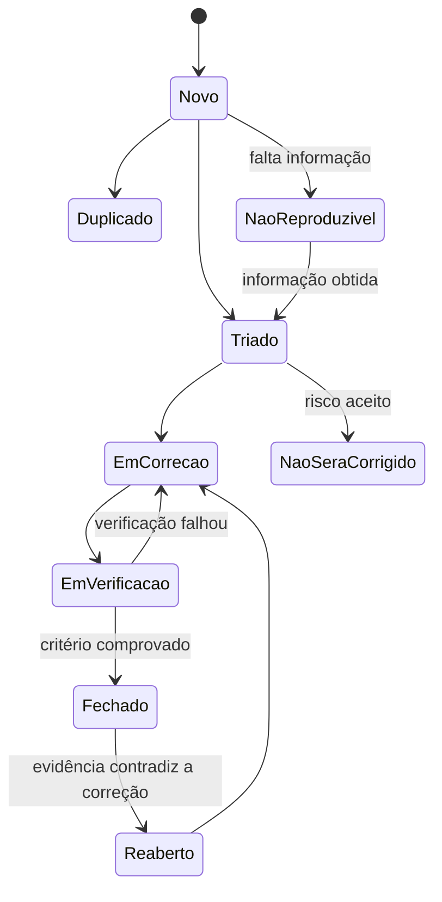

# AlocaSenac — Gestão de Defeitos

> **Origem:** aula de gestão de erros e bugs (semana 36 de `docs/requisitos.md` §9) e o entregável "Registro de defeitos encontrados, priorizados e corrigidos" (`docs/requisitos.md` §7).
> **Princípio:** defeitos não são só itens de backlog, são sinais sobre o sistema de desenvolvimento. Cada correção termina com causa raiz, teste de regressão e rastreabilidade atualizada.

---

## 1. Vocabulário causal

| Termo | Significado | Exemplo no AlocaSenac (ilustrativo) |
|---|---|---|
| Erro humano | Ação ou decisão equivocada | Supor que intervalos que se encostam (fim = início) são sobrepostos |
| Defeito | Problema em um artefato | Comparação de intervalos com `<=` em vez de `<` |
| Falha | Comportamento incorreto executado | Reserva das 10:00 às 11:00 recusada logo após outra das 09:00 às 10:00 |
| Incidente | Evento percebido e investigado | Professora relata que "a sala aparece ocupada, mas está livre" |

Um defeito pode ficar latente; a falha depende das condições que o ativam. Distinguir os termos evita "corrigir" o relato sem investigar o mecanismo.

> Os exemplos desta página são **ilustrativos**. Não são defeitos registrados, e a política de fronteira de intervalos ainda é pergunta aberta (ver `docs/arquitetura.md` §8.5).

---

## 2. Anatomia de um relato reproduzível

Todo defeito é aberto como **GitHub Issue** pelo template [`.github/ISSUE_TEMPLATE/defeito.md`](../.github/ISSUE_TEMPLATE/defeito.md):

- **Título:** ação + condição + resultado observado.
- **Contexto:** versão ou commit, ambiente, perfil e dados não sensíveis.
- **Pré-condições:** estado necessário antes de executar.
- **Passos mínimos:** numerados, sem ações irrelevantes.
- **Esperado e obtido:** lado a lado, ligados ao requisito (ID de `docs/requisitos.md`).
- **Evidência:** resposta sanitizada, log com id de correlação, teste que falha.
- **Frequência, alcance e impacto:** quantificados quando possível.

**Proteção de dados:** nunca anexar senha, token, credencial, matrícula ou dado pessoal real. Usar contas e payloads sintéticos com o domínio reservado `.invalid` (ex.: `mariana.teste@example.invalid`).

---

## 3. Severidade e prioridade

**Severidade mede dano técnico. Prioridade é decisão de planejamento.** As duas são independentes e cada uma exige justificativa.

### 3.1 Severidade
| Nível | Critério | Exemplos de requisitos afetados |
|---|---|---|
| **Crítica** | Ativa um limitador de nota, quebra integridade ou expõe dados | LIM-1 (não executa), LIM-2 (pipeline ausente), LIM-3 (falha de autorização), LIM-4 (dupla reserva) |
| **Alta** | Viola regra crítica sem ativar limitador, ou bloqueia um fluxo principal | RN-T*, RN-E*, RF10 (auditoria perdida) |
| **Média** | Fluxo funciona com contorno, ou um resultado está incorreto sem perda de dados | RF12 (relatório com número errado), RF11 (notificação não enviada) |
| **Baixa** | Cosmético ou de baixo alcance | RF13 (texto ou layout) |

### 3.2 Prioridade
| Nível | Critério |
|---|---|
| **P1** | Corrigir antes de qualquer outro trabalho; bloqueia merge ou entrega |
| **P2** | Corrigir na iteração corrente |
| **P3** | Planejar para uma próxima iteração |
| **P4** | Corrigir quando houver oportunidade; risco aceito até lá |

### 3.3 Severidade × prioridade (exemplos ilustrativos)
| | Baixa prioridade | Alta prioridade |
|---|---|---|
| **Baixa severidade** | Desalinhamento em tela administrativa rara | Texto errado na tela que será demonstrada na apresentação desta semana |
| **Alta severidade** | Falha em relatório de um recurso ainda não cadastrado em nenhuma unidade | Solicitante consegue aprovar reserva de sala restrita (LIM-3) |

---

## 4. Triagem e ciclo de vida

A triagem confirma o fato, remove duplicidade, classifica impacto, decide prioridade, define responsável e o próximo passo. Produto, QA e desenvolvimento trazem perspectivas complementares.

| Estado | Regra |
|---|---|
| Duplicado | Vincular ao issue canônico |
| Não reproduzível | Listar o que falta; **nunca** encerrar em silêncio |
| Não será corrigido | Registrar o risco aceito e quem decidiu |
| Reaberto | Preservar o histórico; a evidência contradiz a correção |
| Em verificação | Quem desenvolve pode marcar |
| Fechado | Exige comprovação no ambiente e na versão definidos: issue ligada ao commit ou PR, teste de regressão identificável e resultado verde reproduzível |

---

## 5. Causa raiz e 5 porquês

Os 5 porquês não exigem exatamente cinco perguntas: a técnica força a atravessar o sintoma até uma condição controlável. Toda correção registra as **ações em camadas**:

1. Domínio ou código (a menor mudança que remove a causa).
2. Persistência ou configuração (ex.: restrição no banco).
3. Teste de regressão (unidade e, quando couber, integração).
4. Rastreabilidade (RTM, documentação ou checklist de revisão).

---

## 6. Fluxo de correção seguro

| Passo | O que fazer |
|---|---|
| 1. Reproduzir | Transformar o relato em teste que **falha** no commit problemático |
| 2. Localizar | Reduzir a hipótese com log, depuração e leitura do fluxo |
| 3. Corrigir | Preferir a menor mudança que remove a causa |
| 4. Regredir | Rodar o teste novo e a suíte completa (`./mvnw -B verify`) |
| 5. Verificar | Aplicar o critério de verificação no ambiente acordado |
| 6. Aprender | Atualizar RTM, documentação ou processo |

**Commits:** a correção referencia a issue (ex.: `fix: <resumo> (#<n>)`), e o teste de regressão cita o requisito no nome.

---

## 7. Métricas

| Usar | Não usar |
|---|---|
| Tempo de ciclo por severidade | Quantidade de bugs por pessoa como produtividade (incentiva fragmentar, esconder ou disputar classificação) |
| Taxa de reabertura | |
| Defeitos escapados por etapa (TDD, CI, revisão, demonstração) | |
| Recorrência por causa raiz | |
| Idade do backlog crítico | |

---

## 8. Registro de defeitos

> A fonte oficial de cada defeito é a GitHub Issue. Esta tabela é o índice, para rastreabilidade e métricas.

| ID | Issue | Título | Severidade | Prioridade | Requisito | Estado | Causa raiz | Teste de regressão | Commit / PR |
|---|---|---|---|---|---|---|---|---|---|
| — | — | Nenhum defeito registrado até agora | — | — | — | — | — | — | — |

### 8.1 Situações das próximas etapas que viram registro
| Situação | Etapa | O que registrar |
|---|---|---|
| Teste que já passa na fase red | Aula 05 (P2) | Caso mal escrito ou regra já implementada: investigar e registrar |
| Teste que parece contradizer a regra na fonte | Aula 06 (P1) | Divergência, pergunta ao grupo e decisão, sem mudar o teste antes da resposta |
| Run vermelho proposital no CI | Aula 06 (P2) | ID do run vermelho, asserção quebrada, revert e ID do run verde |
| Apontamento do SonarCloud | Aula 07 (P2) | Corrigido, aceito com justificativa ou falso positivo com evidência |
